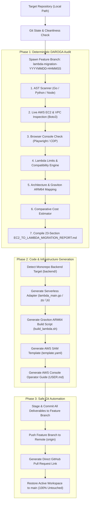
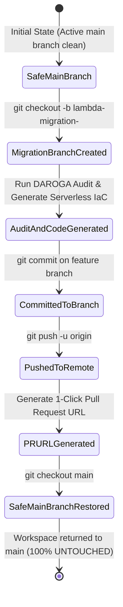
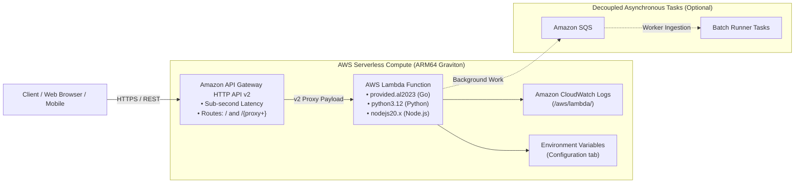
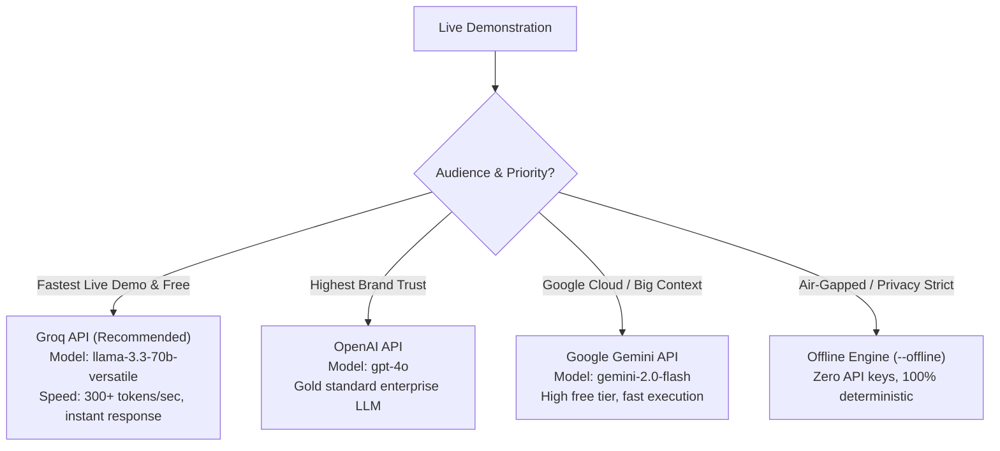

# DAROGA — Autonomous EC2 to AWS Lambda Migration Auditor & Planning Agent

[](https://www.python.org/)
[](https://aws.amazon.com/lambda/)
[](https://aws.amazon.com/api-gateway/)
[](https://aws.amazon.com/serverless/sam/)
[]()
[]()
[](LICENSE)

**DAROGA** is an enterprise-grade autonomous cloud migration agent and auditor CLI designed strictly for moving legacy **AWS EC2-hosted services to AWS Lambda**.

Operating with **zero blast radius**, DAROGA deterministically inspects existing application codebases at **any path**, queries live AWS cloud infrastructure in read-only mode, inspects open AWS Management Console sessions via the Chrome DevTools Protocol (CDP), synthesizes an authoritative **23-section architecture audit report**, generates production serverless code adapters and AWS SAM infrastructure templates, commits everything to an isolated Git feature branch, pushes to your remote Git repository, and generates a ready-to-merge GitHub Pull Request link—while leaving your working branch (`main`) 100% untouched.

---

## Table of Contents

- [Core Value Proposition](#core-value-proposition)
- [Strict Scope: EC2 → AWS Lambda ONLY](#strict-scope-ec2--aws-lambda-only)
- [How It Works: The 11-Stage Pipeline](#how-it-works-the-11-stage-pipeline)
- [System Architecture](#system-architecture)
- [Zero Blast Radius Guarantee](#zero-blast-radius-guarantee)
- [Installation & Setup](#installation--setup)
- [CLI Reference & Usage](#cli-reference--usage)
- [Monorepo Support: Automatic Backend Targeting](#monorepo-support-automatic-backend-targeting)
- [The 23-Section Migration Report (`EC2_TO_LAMBDA_MIGRATION_REPORT.md`)](#the-23-section-migration-report)
- [Generated Serverless Deliverables](#generated-serverless-deliverables)
- [Browser DevTools Protocol (CDP) Console Inspection](#browser-devtools-protocol-cdp-console-inspection)
- [Multi-Provider & Zero-API Offline Mode](#multi-provider--zero-api-offline-mode)
- [Repository Structure](#repository-structure)
- [License](#license)

---

## Core Value Proposition

Migrating from a 24/7 dedicated virtual machine (EC2) to event-driven serverless compute (AWS Lambda) requires assessing runtime boundaries, converting long-lived TCP socket listeners, sizing memory, mapping IAM execution roles, and provisioning API Gateway ingress.

DAROGA unifies this entire workflow into a **single command**:

```bash
daroga "C:\path\to\your-ec2-project"
```

| Phase | What DAROGA Performs | Output Deliverable |
|---|---|---|
| **1. Repository AST Scan** | Discovers entrypoints, continuous socket listeners (`http.ListenAndServe`, `app.run`), ports, and Docker execution calls. | AST Manifest & Language Stack |
| **2. Live AWS Cloud Audit** | Read-only inspection of STS identity, EC2 instance types, VPC topology, and Security Group rules. | Live Infrastructure Delta |
| **3. Browser CDP Inspection** | Read-only inspection of active AWS Management Console tabs via existing Chrome DevTools session. | Console Active State Mapping |
| **4. Compatibility Engine** | Evaluates 15-min timeout, 6MB payload limit, ephemeral `/tmp` storage, and Graviton ARM64 runtime. | Feasibility Verdict & Score |
| **5. 23-Section Report** | Compiles exhaustive migration audit with exact AWS Console click paths and AWS CLI commands. | `EC2_TO_LAMBDA_MIGRATION_REPORT.md` |
| **6. Code & IaC Synthesis** | Generates serverless entrypoint adapter, Graviton build script, and AWS SAM template. | `lambda_main.go`, `build_lambda.sh`, `template.yaml` |
| **7. Operator Guide** | Details exact environment variables, IAM roles, and API Gateway trigger configurations for human review. | `USER.md` & `MIGRATION_REPORT.md` |
| **8. Git Automation & PR** | Creates isolated branch, commits artifacts, pushes to `origin`, and prints GitHub Pull Request link. | `lambda-migration-<timestamp>` |

---

## Strict Scope: EC2 → AWS Lambda ONLY

DAROGA has one singular mission: **moving your specific EC2 workload to AWS Lambda**.

- **No Deflections**: Unlike generic tools that deflect compute workloads to ECS, EKS, or App Runner, DAROGA stays focused on AWS Lambda (ARM64 Graviton) backed by Amazon API Gateway HTTP API v2.
- **Asynchronous Decoupling**: If background batch processes or container sandbox runners are detected, DAROGA architects an asynchronous decoupling plan (API Gateway + Lambda for public HTTP endpoints, routing batch compute to AWS SQS) while keeping the application core serverless.

---

## How It Works: The 11-Stage Pipeline



---

## System Architecture

DAROGA is structured as a modular, deterministic pipeline backed by optional multi-LLM reasoning and a built-in zero-API offline heuristic engine:

```
lambda-agent/
├── agent.py                     # Master CLI Entrypoint & Workflow Orchestrator
├── daroga/                      # Core DAROGA Inspection & Audit Package
│   ├── repository_scanner.py    # Deterministic AST scanner (Go, Python, Node, Dockerfiles)
│   ├── ec2_inspector.py         # Read-only AWS EC2, VPC, Security Group, IAM inspector
│   ├── browser_inspector.py     # Playwright / Chrome DevTools Protocol (CDP) inspector
│   ├── lambda_compatibility.py  # Compatibility scoring engine against Lambda limits
│   ├── architecture_mapper.py   # Topology mapper (Graviton arm64 + API Gateway v2)
│   ├── cost_estimator.py        # Cost analysis (EC2 24/7 vs. Lambda Free Tier)
│   ├── token_tracker.py         # Section 14 token consumption & rule tracker
│   ├── report_generator.py      # Authoritative 23-section report compiler
│   └── orchestrator.py          # Audit pipeline coordinator
├── docs/                        # Complete Architecture & Product Specifications
│   ├── PRD.md                   # Product Requirements Document
│   ├── ARCHITECTURE.md          # In-depth architectural design
│   └── CLI_REFERENCE.md         # Detailed CLI command reference
├── daroga.cmd                   # Windows terminal wrapper
├── setup.py                     # Package setup & console scripts
└── pyproject.toml               # Modern build configuration
```

---

## Zero Blast Radius Guarantee

To guarantee complete safety for enterprise codebases:

1. **Untouched Base Branch**: DAROGA never modifies, stages, or commits to your current active branch (`main`, `master`, `develop`).
2. **Isolated Feature Branching**: All analysis and code generation happens strictly inside an isolated branch named `lambda-migration-<timestamp>`.
3. **Automatic Workspace Restoration**: Even if execution is interrupted or encounters an error, DAROGA's `finally` block safely restores your working branch to its initial state.
4. **Read-Only AWS Inspection**: Live cloud checks only invoke `sts:GetCallerIdentity`, `ec2:DescribeInstances`, `ec2:DescribeSecurityGroups`, and `ec2:DescribeVpcs`. No mutating API calls (`RunInstances`, `ModifyInstance`, `CreateFunction`) are ever issued.
5. **Human-in-the-Loop Review**: Cloud changes are reviewed via a Pull Request. You retain complete control over deployment through AWS SAM or the AWS Console.



---

## Installation & Setup

### Prerequisites
- **Python**: 3.10 or higher
- **Git**: Installed and accessible in your system `PATH`
- **AWS CLI / Credentials** *(Optional)*: If configured, DAROGA automatically inspects your live EC2 instances and VPCs. If not configured, it uses deterministic heuristics.

### 1. Clone & Install Globally

```bash
# Clone the repository
git clone https://github.com/dhawalshankar/lambda-agent.git
cd lambda-agent

# Install dependencies and register CLI commands globally
pip install -r requirements.txt
pip install --no-build-isolation -e .
```

This registers the global executables `daroga` and `aws-migrator`.

---

## CLI Reference & Usage

### Basic Usage

Point DAROGA to any Git repository on your machine:

```bash
# Full migration: Audit + Code Generation + Git Branch Push
daroga "C:\Users\username\Desktop\code\my-ec2-project"

# Linux / macOS
daroga /home/ubuntu/projects/billing-service
```

### Command Options

```text
usage: daroga [repo] [--push | --no-push] [--remote REMOTE]
              [--region REGION] [--instance-id INSTANCE_ID]
              [--cdp-url CDP_URL] [--output OUTPUT]
              [--provider {auto,groq,openai,gemini,claude,anthropic,xai,offline}]
              [--model MODEL] [--api-key API_KEY] [--base-url BASE_URL]
              [--offline] [--audit-only]
```

| Flag | Description | Default |
|---|---|---|
| `repo` | Path to target Git repository | `.` (Current directory) |
| `--push` | Push feature branch to remote git repository and output PR URL | `True` (Enabled) |
| `--no-push` | Keep changes committed strictly to local feature branch | `False` |
| `--remote` | Remote repository name to push to | `origin` |
| `--audit-only` | Run read-only audit to produce report without code generation or branching | `False` |
| `--offline` | Run offline using deterministic architecture engine (zero API calls) | `False` |
| `--region` | AWS region override (e.g. `us-east-1`, `eu-west-1`) | Auto-detected from AWS config |
| `--instance-id` | Specific EC2 instance ID to inspect | Auto-detected |
| `--cdp-url` | Chrome DevTools Protocol URL for live AWS Console inspection | `http://127.0.0.1:9222` |
| `--provider` | AI model provider: `auto`, `groq`, `openai`, `gemini`, `claude`, `xai`, `offline` | `auto` |
| `--model` | Target model identifier (e.g. `llama-3.3-70b-versatile`, `gpt-4o`, `gemini-2.0-flash`) | Auto per provider |

### Common Workflows

```bash
# 1. Standard end-to-end autonomous migration with remote push
daroga /path/to/my-ec2-service

# 2. Local-only migration (no git push)
daroga /path/to/my-ec2-service --no-push

# 3. Read-only architectural audit (no code generation, no git branch)
daroga /path/to/my-ec2-service --audit-only

# 4. Force Zero-API Offline Mode
daroga /path/to/my-ec2-service --offline

# 5. Use specific AI provider and model
daroga /path/to/my-ec2-service --provider groq --model llama-3.3-70b-versatile
```

---

## Monorepo Support: Automatic Backend Targeting

In full-stack repositories where `frontend/` (Next.js, React) and `backend/` (Go, Python, Node.js) live together, DAROGA avoids breaking frontend client code:

1. **Automatic Detection**: It detects the presence of `backend/` and focuses all serverless modifications strictly on the backend service.
2. **Path Scoping**: The generated `template.yaml` configures `CodeUri: backend/`, and runtime adapters are placed directly in the backend directory.
3. **Frontend Ingress Integration**: Generates instructions in `USER.md` explaining how to configure `NEXT_PUBLIC_API_URL` to point to the newly provisioned Amazon API Gateway endpoint.

---

## The 23-Section Migration Report

DAROGA generates **`EC2_TO_LAMBDA_MIGRATION_REPORT.md`** in your repository root, structured according to enterprise cloud audit standards:

1. **Executive Summary & Migration Decision**: Overall verdict (`MIGRATE` or `MIGRATE (WITH DECOUPLING)`), confidence score, and executive rationale.
2. **Repository Architecture Discovery**: Detected languages, frameworks, entrypoints, exposed ports, and dependency manifests.
3. **AWS Infrastructure State Analysis**: Account identity, active region, live EC2 instances vs. target serverless topology.
4. **EC2 Instance Deep Dive**: Instance type, vCPU, memory, virtualization type, public IP, and attached IAM instance profiles.
5. **Security Groups & Network Topology**: Ingress/egress rules, VPC subnets, and security boundaries.
6. **AWS Management Console Live State**: Playwright / CDP findings from currently open AWS Console tabs.
7. **Lambda Compatibility Evaluation**: Runtime boundaries, 15-min timeout, 6MB payload, continuous socket listener conversion, and container sandboxing.
8. **Target Serverless Architecture Design**: Compute model (Graviton `arm64`), HTTP API Gateway v2, CloudWatch structured logs.
9. **Serverless Code Modifications**: Runtime adapter specifications (`lambda_main.go`, `lambda_function.py`, `lambda.js`).
10. **AWS Management Console Step-by-Step Guide**: Click-by-click instructions for creating the Lambda function, setting environment variables, and attaching API Gateway triggers.
11. **AWS CLI Commands**: Ready-to-copy commands (`aws lambda create-function`, `aws apigatewayv2 create-api`).
12. **Infrastructure as Code (AWS SAM)**: Complete production `template.yaml` specification.
13. **Comparative Cost Analysis**: 24/7 EC2 hourly cost vs. AWS Lambda Free Tier (1M requests/month free, 100% savings).
14. **Agent Reasoning Trace & Observability**: Token consumption, files inspected, and deterministic rule counts.
15. **Testing & Validation Strategy**: Sample API Gateway proxy event payloads and curl commands.
16. **Rollback & Disaster Recovery Plan**: Zero-downtime DNS cutover and instant rollback strategies.
17. **Security & Compliance Audit**: IAM least privilege, secret storage (AWS Secrets Manager / SSM), and VPC peering.
18. **CloudWatch Monitoring & Observability**: Metrics (`Invocations`, `Duration`, `Errors`, `Throttles`) and alarm definitions.
19. **Deployment Strategy**: Blue/Green deployments, Canary routing via API Gateway stages, and SAM pipeline steps.
20. **Technical Assumptions & Limitations**: Operational constraints and edge-case handling.
21. **Action Item Checklist**: Pre-migration, migration, and post-migration human tasks.
22. **Decoupled Architecture Notes**: Managing background jobs or sandbox tasks via SQS or ECS Fargate workers.
23. **Sign-Off & Approval Matrix**: Stakeholder sign-off table for engineering leads and cloud architects.

---

## Generated Serverless Deliverables

On every migration run, DAROGA places the following files onto the isolated feature branch:

| File | Purpose |
|---|---|
| **`EC2_TO_LAMBDA_MIGRATION_REPORT.md`** | Authoritative 23-section architecture audit and decision rationale. |
| **`backend/lambda_main.go`** *(Go)* | Serverless HTTP adapter proxying API Gateway events into Go standard HTTP muxes. |
| **`backend/build_lambda.sh`** *(Go)* | Cross-compilation script producing Linux `bootstrap` binary for AWS Lambda Graviton (`provided.al2023`). |
| **`backend/lambda_function.py`** *(Python)* | Production WSGI/ASGI serverless entrypoint using `apig_wsgi` or `mangum`. |
| **`backend/lambda.js`** *(Node)* | Express/Koa serverless adapter using `@vendia/serverless-express`. |
| **`template.yaml`** | AWS SAM template declaring HTTP API Gateway v2, Lambda Graviton compute, and routes. |
| **`USER.md`** | Human operator manual for the AWS Management Console with step-by-step clicks. |

### Target Serverless Topology



---

## Browser DevTools Protocol (CDP) Console Inspection

DAROGA can inspect your currently open AWS Management Console sessions without needing stored passwords or MFA re-authentication:

1. Launch your Google Chrome browser with remote debugging enabled:
   ```bash
   # Windows
   chrome.exe --remote-debugging-port=9222

   # macOS
   /Applications/Google\ Chrome.app/Contents/MacOS/Google\ Chrome --remote-debugging-port=9222

   # Linux
   google-chrome --remote-debugging-port=9222
   ```
2. Navigate to your AWS Management Console (e.g. EC2, VPC, or Lambda dashboard).
3. Run DAROGA:
   ```bash
   daroga /path/to/my-ec2-project
   ```
4. DAROGA connects over CDP (`http://127.0.0.1:9222`), reads active console tabs, maps your current console configuration, and incorporates live findings into Section 6 of the migration report.

---

## Multi-Provider & Zero-API Offline Mode

DAROGA supports all major AI reasoning providers as well as a native offline engine.

### 🌟 Which AI API Should You Use for Live Demonstrations?

When demonstrating DAROGA as an **Autonomous AI Agent** to judges, clients, or evaluators:



| Provider | Recommended Model | Best For | Why Use It In A Demo? |
|---|---|---|---|
| **Groq (Top Recommendation)** ⚡ | `openai/gpt-oss-120b` (OpenAI GPT-OSS 120B) | **Live Stage Demos & Audits** | **Instant speed (~500 tokens/sec)**. OpenAI's official open-weight 120B model running accelerated on Groq LPUs. Unbeatable agentic reasoning with zero latency. Free keys at [console.groq.com](https://console.groq.com). |
| **Groq (Llama)** 🦙 | `llama-3.3-70b-versatile` | **High-Throughput Open Source** | 300+ tokens/sec, proven general coding and instruction-following. |
| **OpenAI** 🧠 | `gpt-4o` | **Client & Executive Presentations** | Maximum brand recognition. Evaluators immediately trust GPT-4o reasoning for code generation. |
| **Google Gemini** 🌐 | `gemini-2.0-flash` | **High Free Limits & Speed** | Extremely fast and generous free rate limits via Google AI Studio. |
| **Anthropic Claude** 🏛️ | `claude-3-5-sonnet-20241022` | **Complex Enterprise Codebases** | Industry-leading coding and tool-calling accuracy. |
| **Offline Heuristic Mode** 🔒 | `static-analysis-engine` | **Air-Gapped / Privacy Clients** | Zero API calls, zero token costs, runs completely offline via `--offline`. |

```bash
# 1. Groq (OpenAI GPT-OSS 120B — recommended for demo: ~500 tokens/sec speed):
export GROQ_API_KEY="gsk_..."
daroga /path/to/my-ec2-app --provider groq --model openai/gpt-oss-120b

# 2. OpenAI:
export OPENAI_API_KEY="sk-..."

# 3. Google Gemini:
export GEMINI_API_KEY="AIzaSy..."

# 4. Anthropic Claude:
export ANTHROPIC_API_KEY="sk-ant-..."

# 5. xAI:
export XAI_API_KEY="xai-..."

# 6. Zero-API Offline Mode (Zero cost, no keys needed):
daroga /path/to/my-ec2-app --offline
```

If an online API key expires or hits token rate limits, DAROGA automatically falls back to the Autonomous Offline Heuristic Engine to guarantee seamless completion.

---

## Repository Structure

```
lambda-agent/
├── README.md                      # Primary System Documentation
├── agent.py                       # Unified CLI & Workflow Orchestrator
├── daroga.cmd                     # Windows command wrapper
├── pyproject.toml                 # Packaging & Console Scripts
├── setup.py                       # Setuptools configuration
├── requirements.txt               # Dependencies
├── daroga/                        # Modular DAROGA Inspection Suite
│   ├── orchestrator.py            # Pipeline coordinator
│   ├── repository_scanner.py      # AST repository scanner
│   ├── ec2_inspector.py           # Boto3 AWS infrastructure inspector
│   ├── browser_inspector.py       # Playwright CDP browser inspector
│   ├── lambda_compatibility.py    # Compatibility evaluation engine
│   ├── architecture_mapper.py     # AWS Serverless topology designer
│   ├── cost_estimator.py          # Cost & Free Tier modeler
│   ├── token_tracker.py           # Section 14 observability tracker
│   └── report_generator.py        # 23-section report generator
├── docs/                          # Detailed Specifications
│   ├── PRD.md                     # Product Requirements Document
│   ├── ARCHITECTURE.md            # Deep Architecture Guide
│   └── CLI_REFERENCE.md           # Complete Command Reference
├── ec2_app/                       # Reference legacy EC2 Flask service
└── lambda_app/                    # Reference migrated serverless service
```

---

## License

This project is licensed under the MIT License. See [LICENSE](LICENSE) for details.
