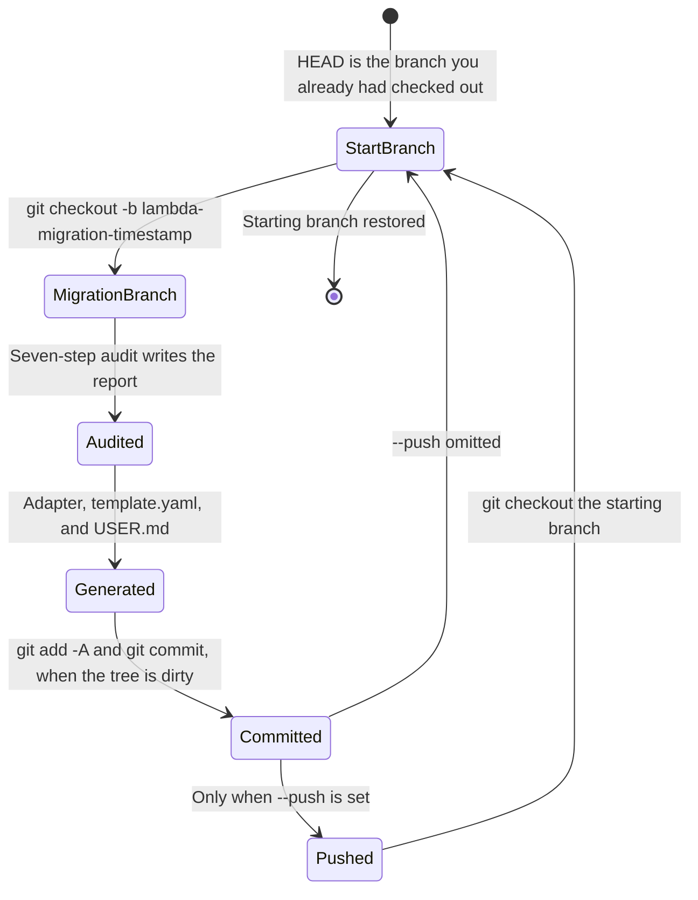
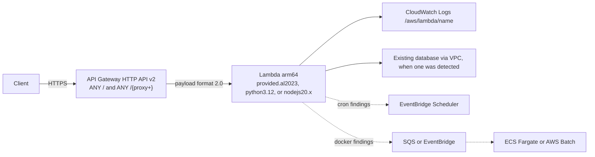
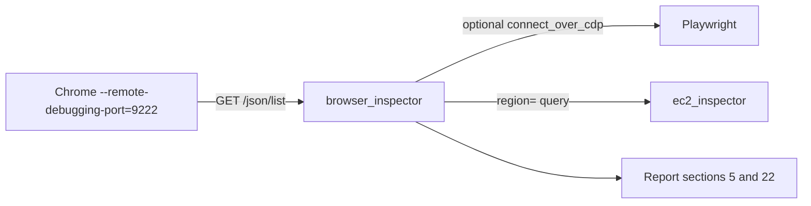
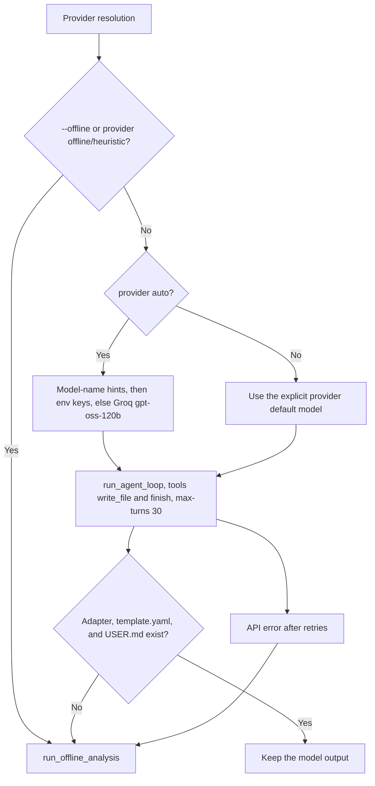

# DAROGA — Autonomous EC2 to AWS Lambda Migration Auditor & Planning Agent

[](https://www.python.org/)
[](https://aws.amazon.com/lambda/)
[](https://aws.amazon.com/api-gateway/)
[](https://aws.amazon.com/serverless/sam/)
[]()
[]()


**DAROGA** is an autonomous cloud migration auditor and CLI for moving legacy **AWS EC2-hosted HTTP services to AWS Lambda**.

It inspects a local repository at any path, queries live AWS infrastructure with read-only API calls, reads an already-open Chrome session over the Chrome DevTools Protocol (CDP), and writes a **23-section** `EC2_TO_LAMBDA_MIGRATION_REPORT.md`. On a full run it then generates a serverless adapter, an AWS SAM template, and `USER.md` on an isolated Git branch (`lambda-migration-<timestamp>`). With `--push` it pushes that branch and opens a pull request through the GitHub CLI, falling back to a one-click compare URL. The branch you started on is checked out again when the run finishes.

---

## Table of Contents

- [What DAROGA Does](#what-daroga-does)
- [Scope](#scope)
- [How a Run Proceeds](#how-a-run-proceeds)
- [System Layout](#system-layout)
- [Verdicts](#verdicts)
- [Zero Blast Radius](#zero-blast-radius)
- [Installation](#installation)
- [CLI Reference](#cli-reference)
- [In-Guest VM Inspection](#in-guest-vm-inspection)
- [Monorepos](#monorepos)
- [The 23-Section Report](#the-23-section-report)
- [Generated Deliverables](#generated-deliverables)
- [Browser CDP Inspection](#browser-cdp-inspection)
- [Model Providers](#model-providers)
- [Repository Structure](#repository-structure)
- [License](#license)

---

## What DAROGA Does

DAROGA is project-agnostic. Point it at a local Git tree (Go, Python, JavaScript/TypeScript, and, for scanning, Java or Rust). It:

1. Parses the tree for language, framework, entrypoints, ports, Docker execution, WebSockets, local SQLite, cron loops, and databases.
2. Connects to Chrome on CDP port `9222` when that port is open, and uses an AWS Console `region=` query parameter as the inspection region when `--region` was not passed.
3. Calls AWS with boto3 (AWS CLI as fallback) for caller identity, EC2 instances, VPCs, subnets, security groups, and a short IAM role list. If the chosen region has no instances and `--instance-id` was not set, it searches a fixed candidate-region list.
4. Scores the service against Lambda limits and maps a target of **ARM64 Graviton** plus **API Gateway HTTP API v2**.
5. Writes `EC2_TO_LAMBDA_MIGRATION_REPORT.md`.
6. On a full run, optionally collects in-guest telemetry (`--vm-access`) and generates serverless files with an LLM (`write_file` and `finish` only). If that session does not leave a complete set of files, the offline engine writes them.

| Phase | What runs | Result |
|---|---|---|
| Repository scan | `daroga/repository_scanner.py` | Language, entrypoints, ports, blockers, `backend/` scope |
| Browser CDP | `daroga/browser_inspector.py` | Open AWS Console tabs; region hint for the AWS call |
| Live AWS audit | `daroga/ec2_inspector.py` | Account, instances, VPC, security groups, IAM role names |
| Compatibility | `daroga/lambda_compatibility.py` | Score, verdict, runtime, memory (512 MB), timeout (30 s) |
| Architecture | `daroga/architecture_mapper.py` | Lambda, HTTP API, CloudWatch, IAM, EventBridge when cron exists |
| Cost | `daroga/cost_estimator.py` | EC2 vs Lambda. Savings stay an **ESTIMATE** when no live instance is found |
| Report | `daroga/report_generator.py` | 23-section markdown report |
| VM telemetry | `daroga/vm_inspector.py` | SSM, then SSH. Full migration only. Injected into the code-generation prompt |
| Code generation | `agent.py` | Adapter, Go build script, `template.yaml`, `USER.md` |
| Git | `agent.py` | Commit on `lambda-migration-<timestamp>`, optional push and PR, restore the starting branch |

---

## Scope

The public HTTP service is planned onto **AWS Lambda (arm64)** behind **Amazon API Gateway HTTP API v2**.

When the scanner finds work Lambda cannot host directly, the verdict becomes **`MIGRATE (WITH DECOUPLING)`** and the report records a condition:

| Finding | Planned change |
|---|---|
| `docker run`, Docker socket, or a container client | Keep the HTTP API on Lambda. Move container execution to an ECS Fargate task (or AWS Batch) started from SQS or EventBridge |
| WebSocket server (`gorilla/websocket`, `socket.io`, and similar) | API Gateway WebSocket API, with connection state in DynamoDB |
| SQLite or other local disk state | S3, DynamoDB, or RDS. Ephemeral `/tmp` is 512 MB–10 GB and is not durable |
| In-process cron | EventBridge Scheduler invoking Lambda |
| Relational database drivers | Connection created in global scope; RDS Proxy when connection counts matter |

A critical-severity finding produces **`NOT RECOMMENDED`**. Java and Rust are indexed by the scanner. Generated adapters are written for Go (`provided.al2023`), Python (`python3.12`), and Node.js (`nodejs20.x`).

---

## How a Run Proceeds

The audit inside `DarogaOrchestrator.run_audit` is seven ordered steps. Code generation, VM inspection, and Git happen in `daroga_main` around that audit. CDP runs **before** the AWS calls so an open console tab can supply the region.

```mermaid
flowchart TD
    A["daroga [repo] [flags]"] --> B{"Target directory exists?"}
    B -- "No" --> X["Exit 1"]
    B -- "Yes" --> C{"Git repository?"}
    C -- "No" --> C1["git init, add, and an initial commit"]
    C -- "Yes" --> D{"Working tree clean?"}
    C1 --> D
    D -- "No" --> X2["Exit 1: commit or stash first"]
    D -- "Yes" --> E{"--audit-only?"}

    E -- "Yes" --> AUDIT
    E -- "No" --> BR["git checkout -b lambda-migration-YYYYMMDD-HHMMSS"]
    BR --> AUDIT

    subgraph AUDIT ["DarogaOrchestrator.run_audit"]
        S1["1. repository_scanner"] --> S2["2. browser_inspector on --cdp-url"]
        S2 --> S3["3. ec2_inspector. Region from --region, else CDP, else AWS config, else us-east-1. Candidate-region search if no instances"]
        S3 --> S4["4. lambda_compatibility"]
        S4 --> S5["5. architecture_mapper"]
        S5 --> S6["6. cost_estimator"]
        S6 --> S7["7. report_generator writes EC2_TO_LAMBDA_MIGRATION_REPORT.md"]
    end

    S7 --> E2{"Full migration?"}
    E2 -- "audit-only" --> ENDA["Return. No branch, no VM, no generated code"]
    E2 -- "full run" --> VM{"--vm-access or --ssh-key, and a discovered instance?"}
    VM -- "Yes" --> VM1["VMInspector: SSM Run Command, then SSH"]
    VM -- "No" --> CG
    VM1 --> CG["Code generation: LLM write_file and finish, then offline engine if files are incomplete"]

    CG --> FIN["finally: commit on the migration branch if the tree is dirty"]
    FIN --> PUSH{"--push?"}
    PUSH -- "Yes" --> PR["git push -u remote branch, then gh pr create, else a GitHub or GitLab compare URL"]
    PUSH -- "No" --> LOCAL["Print the manual push and gh pr create commands"]
    PR --> REST["git checkout the branch that was current at start"]
    LOCAL --> REST
    REST --> EMPTY{"Migration branch has no new commits?"}
    EMPTY -- "Yes" --> DEL["git branch -D the empty migration branch"]
    EMPTY -- "No" --> DONE["Print verdict, conditions, blockers"]
    DEL --> DONE
```



The model session is capped by `--max-turns` (default **30**). The prompt already contains the audit summary, up to 1,200 characters of the entrypoint, and guest telemetry when that inspection succeeded. The tools passed to the model are `write_file` and `finish`.

---

## System Layout

```
lambda-agent/
├── agent.py                     # CLI, model client, codegen, Git, pull request
├── daroga/
│   ├── orchestrator.py          # Seven-step audit coordinator
│   ├── repository_scanner.py    # Language, entrypoints, ports, blockers, backend scope
│   ├── browser_inspector.py     # CDP /json/list, optional Playwright attach
│   ├── ec2_inspector.py         # Read-only STS, EC2, VPC, security groups, IAM
│   ├── vm_inspector.py          # SSM then SSH guest telemetry
│   ├── lambda_compatibility.py  # Limits, score, verdict
│   ├── architecture_mapper.py   # Target Lambda + HTTP API topology
│   ├── cost_estimator.py        # EC2 on-demand vs Lambda free tier
│   ├── token_tracker.py         # Section 23 inspection counters
│   └── report_generator.py      # 23-section report
├── docs/
│   ├── PRD.md
│   ├── ARCHITECTURE.md
│   ├── CLI_REFERENCE.md
│   └── customer.md
├── tests/test_auditor.py
├── ec2_app/                     # Reference Flask service (EC2 style)
├── lambda_app/                  # Reference Flask service already wrapped for Lambda
├── daroga.cmd
├── aws-migrator.cmd
├── aws_migrator.cmd
├── pyproject.toml
└── setup.py
```

Console scripts registered by the package: `daroga`, `aws-migrator`, and `aws_migrator`. All three call `agent:daroga_main`.

---

## Verdicts

`LambdaCompatibilityEngine` sets one of these strings:

| Verdict | When |
|---|---|
| `MIGRATE (FULLY COMPATIBLE)` | No medium, high, or critical findings. Score 95 |
| `MIGRATE (WITH CODE MODIFICATIONS)` | Medium findings and no high or critical findings. Score 80 |
| `MIGRATE (WITH DECOUPLING)` | One or more high findings (Docker execution, WebSockets, local SQLite). Score capped at 60 |
| `NOT RECOMMENDED` | Any critical finding. Score capped at 40 |

A normal HTTP service still has a medium finding for converting `ListenAndServe` / `app.run()` into an API Gateway event, so the usual clean verdict is **`MIGRATE (WITH CODE MODIFICATIONS)`**.

---

## Zero Blast Radius

1. The starting branch is never the commit target. Work is committed on `lambda-migration-<YYYYMMDD-HHMMSS>`.
2. The `finally` block checks that branch back out, including after an error or Ctrl+C. That branch is whatever `HEAD` was, including `main`, `master`, or a feature branch.
3. A migration branch with no commits relative to the start is deleted.
4. Cloud inventory uses read-only calls: `sts:GetCallerIdentity`, `ec2:DescribeInstances`, `ec2:DescribeVpcs`, `ec2:DescribeSubnets`, `ec2:DescribeSecurityGroups`, and `iam:ListRoles` (max 10). There is no `RunInstances`, `CreateFunction`, or `sam deploy`.
5. `--vm-access` is the exception that sends work to the instance: SSM `AWS-RunShellScript` (or SSH) runs the read-only diagnostic script (`ss`, `systemctl`, `ps`, `docker ps`, `df`, crontab). It does not change guest files.
6. CDP reads tab titles and URLs. Cookies, passwords, and tokens are not stored.
7. Deployment stays with the operator (`sam deploy` or the console steps in `USER.md`).



---

## Installation

- Python 3.10 or newer
- Git on `PATH`
- AWS credentials are optional. Without them the audit continues with heuristics and labels cost as an estimate
- `gh` is optional. `--push` uses it to open the pull request and otherwise prints a compare URL

```bash
git clone https://github.com/dhawalshankar/lambda-agent.git
cd lambda-agent
pip install -e .
```

`pip install -e .` installs the dependencies declared in `pyproject.toml`: `groq`, `openai`, `anthropic`, `boto3`, `pyyaml`, and `playwright`. `requirements.txt` lists only the three LLM SDKs, so it is not a complete install by itself.

Playwright is used only as an optional second pass after the CDP HTTP listing. Tab discovery works through `http://127.0.0.1:9222/json/list` without a Playwright browser download. For the Playwright attach:

```bash
python -m playwright install chromium
```

---

## CLI Reference

```text
usage: daroga [repo] [--push | --no-push] [--remote REMOTE]
              [--region REGION] [--instance-id INSTANCE_ID]
              [--cdp-url CDP_URL] [--output OUTPUT]
              [--provider {auto,groq,openai,gemini,claude,anthropic,xai,ollama,offline,heuristic,custom}]
              [--model MODEL] [--api-key API_KEY] [--base-url BASE_URL]
              [--offline] [--audit-only | --audit]
              [--vm-access] [--ssh-key SSH_KEY] [--ssh-user SSH_USER]
              [--max-turns N]
```

| Flag | Default | Behavior |
|---|---|---|
| `repo` | `.` | Target directory. A missing `.git` is initialized and given an initial commit |
| `--push` / `--no-push` | `--no-push` | Push `lambda-migration-*` and open a PR. Off unless `--push` is passed |
| `--remote` | `origin` | Remote name for `--push` |
| `--audit-only`, `--audit` | off | Report only. No branch, no VM inspection, no codegen |
| `--offline` | off | Skip the model and run `run_offline_analysis` |
| `--vm-access` | off | Guest telemetry on the full migration path |
| `--ssh-key` | none | PEM or private key. Also turns guest inspection on. Extra keys are taken from `~/.ssh` and a few well-known filenames |
| `--ssh-user` | `ubuntu` | First SSH user. When the value is `ubuntu`, the inspector also tries `ec2-user` and `root` |
| `--region` | AWS config, else CDP, else `us-east-1` | Starting region. Empty instance lists trigger a candidate-region search unless `--instance-id` is set |
| `--instance-id` | first discovered instance | Pins `DescribeInstances` |
| `--cdp-url` | `http://127.0.0.1:9222` | Chrome remote-debugging endpoint |
| `--output` | `<repo>/EC2_TO_LAMBDA_MIGRATION_REPORT.md` | Report path |
| `--provider` | `auto` | See [Model Providers](#model-providers). `openrouter` is not a CLI choice; use `custom` |
| `--model` | provider default | Passed through to the client |
| `--api-key` | environment | Overrides the provider key |
| `--base-url` | provider default | OpenAI-compatible base URL for `custom` and overrides |
| `--max-turns` | `30` | Model loop limit |

```bash
daroga /path/to/my-ec2-service
daroga /path/to/my-ec2-service --push
daroga /path/to/my-ec2-service --vm-access
daroga /path/to/my-ec2-service --vm-access --ssh-key ~/.ssh/my-key.pem --ssh-user ec2-user
daroga /path/to/my-ec2-service --audit-only
daroga /path/to/my-ec2-service --offline
daroga /path/to/my-ec2-service --provider groq --model openai/gpt-oss-120b
daroga /path/to/my-ec2-service --provider custom --base-url http://localhost:11434/v1 --model llama3.1:8b
```

A longer flag list, environment variables, and exit behavior are in [docs/CLI_REFERENCE.md](docs/CLI_REFERENCE.md). A non-developer walkthrough is in [docs/customer.md](docs/customer.md).

---

## In-Guest VM Inspection

`--vm-access` and `--ssh-key` run only after a **full** audit, and only when `ec2_inspector` returned at least one instance. `--audit-only` returns before this step, so the flag has no effect in that mode.

Order inside `VMInspector.inspect_instance`:

1. **SSM.** `ssm:DescribeInstanceInformation`, then `AWS-RunShellScript` if the instance is a managed instance. The script is the read-only command set below. Timeout on the document is 30 seconds.
2. **SSH.** Uses `--ssh-key` when given, then `~/.ssh/golab-key.pem`, `~/.ssh/id_rsa`, `~/.ssh/id_ed25519`, `~/Downloads/golab-key.pem`, `~/Downloads/firsttimer.pem`, and every `*.pem` in `~/.ssh`. Connect timeout is 5 seconds.

Collected sections: `/etc/os-release`, `ss -tulpn` (or `netstat`), running systemd units, `ps aux`, `docker images`, `docker ps -a`, `/opt`, `/var/www`, `/home/*`, crontab, and `df -h /`.

Successful telemetry is appended to the model prompt (`guest_telemetry` on the audit result). The 23-section report writer does not receive that object, so guest sockets do not appear as their own report section.

---

## Monorepos

`RepositoryScanner` prefers a `backend/` directory as `target_service_directory` and scores language from that directory’s manifests, so a Next.js `frontend/` does not become the Lambda target.

Generated files follow that directory:

- Go: `<target>/lambda_main.go` and `<target>/build_lambda.sh` (`GOOS=linux GOARCH=arm64`, output `bootstrap`)
- Python: `<target>/lambda_function.py` (`apig_wsgi`, then Mangum)
- Node: `<target>/lambda.js` (`@vendia/serverless-express`)
- `template.yaml` at the repository root with `CodeUri` set to that directory
- `USER.md` at the repository root, including a `NEXT_PUBLIC_API_URL` example for a frontend

---

## The 23-Section Report

`report_generator.py` writes these headings, in this order:

1. Executive Summary
2. Existing Application Architecture
3. Repository Analysis
4. Existing EC2 Configuration
5. Existing AWS Dependencies (includes the browser CDP cross-check)
6. Existing Networking Architecture
7. Relevant IAM Configuration
8. Lambda Compatibility Assessment
9. Migration Blockers
10. Proposed Lambda Architecture
11. Required AWS Resources
12. IAM Execution Role Requirements
13. API Gateway Configuration
14. Networking and Database Configuration
15. Required Application Code Changes
16. Step-by-Step AWS Console Instructions
17. Copy-Paste-Ready AWS CLI Commands
18. Cost and Free-Tier Assessment
19. Verification Checklist
20. Rollback Procedure
21. Final Migration Readiness Assessment
22. Inspection Limitations (CDP note lives here as well)
23. LLM Usage and Token Consumption Summary (`token_tracker.py` file counts, AWS resource counts, and deterministic finding counts)

Section 18 does not invent a 100% savings figure when no EC2 instance was returned. In that case the savings label is `ESTIMATE (no live instance data - depends on actual EC2 type)`. With a live instance, low-traffic Lambda is priced at `$0.00` inside the permanent free tier (1,000,000 requests and 3,200,000 GB-seconds). HTTP API’s 1,000,000 free calls apply for the first 12 months. A 30 GB gp3 volume is included in the EC2 baseline at `$0.08/GB-month`. Moderate traffic in the estimator is 2,500,000 requests at about `$1.80/month`, plus `$5.00` when Docker decoupling is flagged.

An untracked `EC2_TO_LAMBDA_MIGRATION_REPORT.md` left in the target from an earlier run is deleted before the clean-tree check so a previous audit does not block the next one.

---

## Generated Deliverables

Committed on the migration branch when the generators run:

| File | Role |
|---|---|
| `EC2_TO_LAMBDA_MIGRATION_REPORT.md` | 23-section audit |
| `lambda_main.go` and `build_lambda.sh` | Go adapter and ARM64 `bootstrap` build, under the target directory |
| `lambda_function.py` | Python handler |
| `lambda.js` | Node handler |
| `template.yaml` | SAM: `arm64`, runtime `provided.al2023` / `python3.12` / `nodejs20.x`, HTTP API routes `/` and `/{proxy+}` |
| `USER.md` | SAM and console steps for the operator |

`MIGRATION_REPORT.md` under `lambda_app/` is a short write-up of the bundled reference service. The CLI does not emit that filename.



The checked-in `lambda_app/template.yaml` is an older reference stack and pins **Python 3.11**. New templates written by `run_offline_analysis` use **python3.12**.

---

## Browser CDP Inspection

```bash
# Windows
chrome.exe --remote-debugging-port=9222

# macOS
"/Applications/Google Chrome.app/Contents/MacOS/Google Chrome" --remote-debugging-port=9222

# Linux
google-chrome --remote-debugging-port=9222
```

Open the AWS console in that Chrome, then run `daroga`. The inspector GETs `/json/version` and `/json/list`, keeps page targets whose URL contains `console.aws.amazon.com` or `amazonaws.com`, and reads `region=` for the AWS inspector when `--region` is empty. Playwright’s `connect_over_cdp` is a best-effort confirmation and is skipped when Playwright is missing. A closed port is recorded in sections 5 and 22 and does not stop the audit.



---

## Model Providers

`--provider auto` resolves in this order:

1. **`--model` hints.** `gpt-oss`, `120b`, or a name starting with `openai/` selects Groq. `claude` selects Anthropic. `gemini` selects Gemini. `gpt`, `o1`, or `o3` selects OpenAI. `grok` selects xAI. `llama` or `mixtral` selects Groq.
2. **Environment.** The first key that is set wins: `GROQ_API_KEY`, then `OPENAI_API_KEY`, then `GEMINI_API_KEY` or `GOOGLE_API_KEY`, then `ANTHROPIC_API_KEY`, then `XAI_API_KEY`, then `OPENAI_BASE_URL` (provider `custom`).
3. **Fallback.** Groq and `openai/gpt-oss-120b`.

Explicit `--provider` defaults differ from the auto-detected defaults:

| `--provider` | Default `--model` | Key / endpoint |
|---|---|---|
| `groq` | `openai/gpt-oss-120b` | `GROQ_API_KEY` |
| `openai` | `gpt-4o-mini` | `OPENAI_API_KEY`. Auto-detect with that key and no `--model` uses `gpt-4o` |
| `gemini` | `gemini-4-hydrogen` | `GEMINI_API_KEY` or `GOOGLE_API_KEY`, base `https://generativelanguage.googleapis.com/v1beta/openai/`. Auto-detect uses `gemini-2.0-flash` |
| `claude`, `anthropic` | `claude-3-5-haiku-20241022` | `ANTHROPIC_API_KEY`. Auto-detect uses `claude-3-5-sonnet-20241022` |
| `xai` | `grok-2-latest` | `XAI_API_KEY`, base `https://api.x.ai/v1` |
| `ollama` | `llama3.1:8b` | `http://localhost:11434/v1` or `OLLAMA_BASE_URL` |
| `custom` | `default` | `--base-url` or `OPENAI_BASE_URL`. This is the CLI path for OpenRouter, vLLM, and LM Studio |
| `offline`, `heuristic` | `static-analysis-engine` | No network |

```bash
# Groq, explicit default model
export GROQ_API_KEY="gsk_..."
daroga /path/to/app --provider groq

# Local OpenAI-compatible server
daroga /path/to/app --provider ollama --model llama3.1:8b

# OpenRouter (custom provider; openrouter is not an argparse choice)
daroga /path/to/app --provider custom --base-url "https://openrouter.ai/api/v1" --model "meta-llama/llama-3.3-70b-instruct" --api-key "$OPENROUTER_API_KEY"

# No model call
daroga /path/to/app --offline
```

If the online call errors, or the adapter, `template.yaml`, and `USER.md` are not all present afterward, `run_offline_analysis` writes the deterministic files. Rate limits are retried inside `call_ai_with_retry` before that handoff.

The offline writer decides Go vs Python vs Node by comparing `audit_res.target_runtime` to the words `go`, `python`, and `node`. The audit stores the Lambda runtime id (`provided.al2023`, `python3.12`, `nodejs20.x`) in that field, so a failover that still has an audit result does not take those branches and emits a Node `template.yaml` runtime. File-extension detection runs only when the audit result has no `target_runtime`. The model prompt has the same comparison when it picks the suggested adapter filename, and it also includes the entrypoint source, which is what the model actually writes from.



---

## Repository Structure

```
lambda-agent/
├── README.md
├── agent.py
├── pyproject.toml
├── setup.py
├── requirements.txt          # LLM SDKs only; use pip install -e . for the full set
├── daroga.cmd
├── aws-migrator
├── aws-migrator.cmd
├── aws_migrator
├── aws_migrator.cmd
├── daroga/
├── docs/
│   ├── ARCHITECTURE.md
│   ├── CLI_REFERENCE.md
│   ├── PRD.md
│   └── customer.md
├── tests/test_auditor.py
├── ec2_app/
└── lambda_app/
```

---

## License

This project is licensed under the MIT License.
