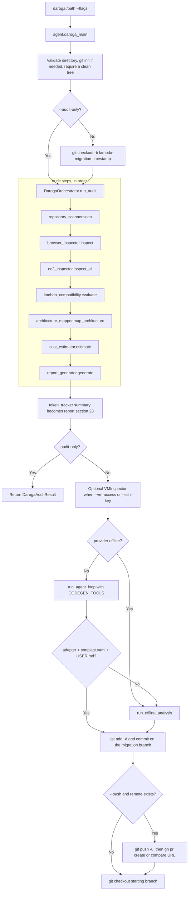
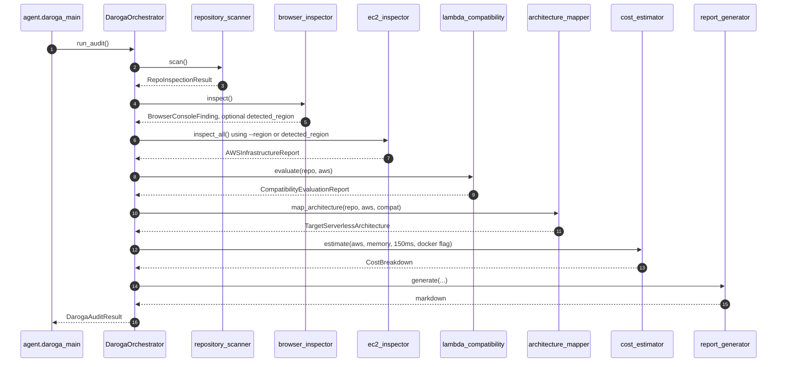
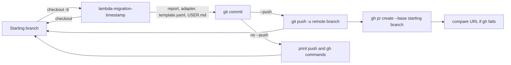
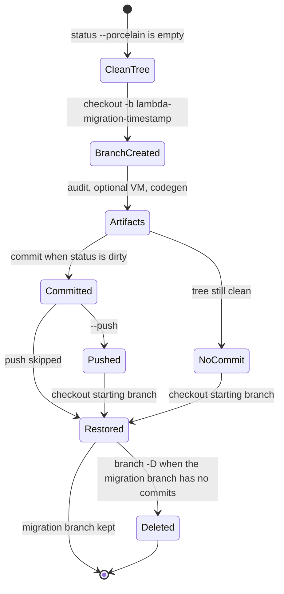

# DAROGA System Architecture

Technical map of the inspection pipeline, code generation, and Git lifecycle in **DAROGA** v2.0. Behavior below matches `agent.py` and the `daroga` package.

---

## 1. Design Rules

1. **Facts before the model.** `DarogaOrchestrator.run_audit` finishes the scan, CDP check, AWS inventory, compatibility rules, architecture map, cost math, and the markdown report before `run_agent_loop` starts.
2. **Isolated Git branch.** Commits land on `lambda-migration-<YYYYMMDD-HHMMSS>`. The `finally` block checks out the branch that was current when the process started.
3. **Operators deploy.** The tool writes `template.yaml` and `USER.md`. It does not call `sam deploy` or mutating Lambda/EC2 APIs. `--vm-access` may send an SSM shell script whose commands are diagnostic.

---

## 2. Component Diagram

### 2.1 Audit sequence

`DarogaAuditResult` carries `verdict`, `score`, `blockers`, `conditions`, `target_runtime` (the recommended Lambda runtime string), and the structured `repo`, `aws`, `compat`, `arch`, and `cost` objects. Guest telemetry is attached later, in `daroga_main`, as `audit_res.guest_telemetry`. The report generator’s signature does not take that field.

---

## 3. Modules

### 3.1 Repository scanner (`daroga/repository_scanner.py`)

Walks the tree and skips dependency and build directories. It scores Go, Python, JavaScript, TypeScript, Java, and Rust, then sets `target_service_directory` from `backend/` when that directory exists, otherwise from the first entrypoint’s parent.

It records entrypoints, ports, package manifests, Dockerfiles, nginx configs, CI files, database types, Docker execution (`docker run`, `/var/run/docker.sock`, docker clients), WebSockets, SQLite and local storage, and scheduled jobs.

### 3.2 Browser inspector (`daroga/browser_inspector.py`)

1. GET `{cdp-url}/json/version` with a 1.5 s timeout.
2. GET `{cdp-url}/json/list` and keep targets of type `page`.
3. AWS tabs are those whose URL contains `console.aws.amazon.com` or `amazonaws.com`, or whose title contains `AWS Management Console`.
4. A `region=` query parameter becomes `detected_region` and, when `--region` was omitted, the region passed into `EC2Inspector`.
5. If Playwright is importable, `chromium.connect_over_cdp` (2.5 s) appends a confirmation note. Failures are swallowed.

Closed CDP is a note in report sections 5 and 22.

### 3.3 EC2 inspector (`daroga/ec2_inspector.py`)

Region resolution: constructor argument, then `AWS_REGION`, then `AWS_DEFAULT_REGION`, then `us-east-1`. The orchestrator passes the CDP region into that constructor when the CLI region is empty.

When identity checks succeed, the inspector calls:

- `ec2:DescribeInstances` (optional `InstanceIds`)
- If the instance list is empty and no `--instance-id` was given, the same describe in `ap-southeast-2`, `us-east-1`, `us-east-2`, `us-west-2`, `ap-south-1`, `eu-west-1`, `eu-central-1`, `ap-southeast-1`, skipping the region already tried. The first region with instances becomes the active region for VPC and security-group calls.
- `ec2:DescribeVpcs`, `ec2:DescribeSubnets`, `ec2:DescribeSecurityGroups`
- `iam:ListRoles` with `MaxItems=10`

boto3 is preferred. `DescribeInstances` falls back to the `aws` CLI. Permission errors are stored on `errors_or_notes` and the pipeline continues. The module docstring mentions load balancers; `inspect_all` does not call ELB APIs, and `load_balancers` stays empty.

### 3.4 VM inspector (`daroga/vm_inspector.py`)

Invoked from `daroga_main` only when the run is not `--audit-only` and (`--vm-access` or `--ssh-key`) and `audit_res.aws.instances` is non-empty. The target is `instances[0]`.

Access order:

1. SSM `DescribeInstanceInformation`, then `SendCommand` on `AWS-RunShellScript`, polled for up to about 20 seconds.
2. SSH to `public_ip` with the explicit key and then discovered keys (`*.pem` under `~/.ssh`, plus `id_rsa`, `id_ed25519`, and two historical filenames under `~/.ssh` and `Downloads`). Users tried: `--ssh-user` (default `ubuntu`); when that default is left as `ubuntu`, also `ec2-user` and `root`.

The module header mentions EC2 Instance Connect. `inspect_instance` does not call it.

Parsed fields: OS, listening sockets, systemd units, processes, Docker images, Docker containers, app directories, cron lines, disk usage. The prompt builder forwards OS, up to five sockets, six services, four images, and four containers.

### 3.5 Compatibility engine (`daroga/lambda_compatibility.py`)

| Rule | Topic |
|---|---|
| `RULE-RNT-01/02/03` | Go `provided.al2023`, Python `python3.12`, Node `nodejs20.x` |
| `RULE-NET-01` | Continuous listener becomes API Gateway. Severity medium, so a plain HTTP app scores 80 and verdict `MIGRATE (WITH CODE MODIFICATIONS)` |
| `RULE-CNT-01` | Docker execution. High. Condition: ECS Fargate or Batch via SQS or EventBridge |
| `RULE-WBS-01` | WebSockets. High. API Gateway WebSocket API and DynamoDB |
| `RULE-STR-01` | SQLite / local disk. High. S3, DynamoDB, or RDS |
| `RULE-LIM-01` | 900 s Lambda ceiling. High only when Docker execution was also detected; otherwise informational, with the API Gateway 30 s note |
| `RULE-LIM-02` | 6 MB synchronous payload |
| `RULE-LIM-03` | `/tmp` 512 MB–10 GB |
| `RULE-JOB-01` | Cron becomes EventBridge Scheduler |
| `RULE-DB-01` | Pools in global scope; RDS Proxy for Postgres/MySQL |

Verdict ladder: critical → `NOT RECOMMENDED` (score ≤ 40); else any high → `MIGRATE (WITH DECOUPLING)` (score ≤ 60); else any medium → `MIGRATE (WITH CODE MODIFICATIONS)` (80); else `MIGRATE (FULLY COMPATIBLE)` (95).

Defaults that the report prints when a rule does not override them: memory **512 MB**, timeout **30 s**. `run_offline_analysis` hardcodes the same memory and timeout in `template.yaml`.

### 3.6 Architecture mapper (`daroga/architecture_mapper.py`)

Always proposes Lambda arm64, API Gateway HTTP API v2 (`ANY /{proxy+}`, payload format 2.0), CloudWatch Logs, and an IAM role named `{repo}-LambdaExecutionRole` with `AWSLambdaBasicExecutionRole`. A VPC id on the first instance adds `AWSLambdaVPCAccessExecutionRole`. Detected databases are reused. `has_scheduled_jobs` adds EventBridge Scheduler.

### 3.7 Cost estimator (`daroga/cost_estimator.py`)

On-demand Linux hourly rates for a fixed set of `t2`, `t3`, `t4g`, `m5.large`, and `c5.large` sizes, times 730 hours, plus 30 GB gp3 at `$0.08/GB-month`. Unknown types use the `t3.micro` hourly rate (`0.0104`).

Lambda low traffic (under 1,000,000 requests) is `$0.00`. Moderate traffic (2,500,000 requests) is `$1.80` (`$0.30` Lambda invocations + `$1.50` API Gateway). Docker decoupling adds a `$5.00` Fargate allowance on the moderate figure. Savings percent is computed only when a live instance exists. Otherwise `savings_label` is the ESTIMATE string and `monthly_savings_percent` is `None`.

Free-tier text in the report: Lambda requests and GB-seconds are permanent; HTTP API’s 1,000,000 calls are the first 12 months; CloudWatch includes 5 GB ingestion.

### 3.8 Token tracker (`daroga/token_tracker.py`)

The orchestrator records files scanned, AWS resource count (instances + security groups + VPCs), and the number of compatibility findings. It does not record LLM token counts today; section 23 prints those counters as zeros unless something else calls `record_llm_call`. The model loop does not call the tracker.

### 3.9 Report generator (`daroga/report_generator.py`)

Writes the 23 headings listed in the README, from the structured audit objects. Console click-path is section 16. CLI snippets are section 17 and are marked for the operator to run. Section 10 is an ASCII diagram of Client → HTTP API → Lambda → CloudWatch and the existing database.

### 3.10 Code generation (`agent.py`)

`CODEGEN_TOOLS` is `write_file` and `finish`. A larger `TOOLS` list (`list_files`, `read_file`, `search`, `run_command`) exists in the file and is not passed into `run_agent_loop`.

`run_agent_loop` builds a user message from verdict, runtime, conditions, blockers, entrypoints, ports, frameworks, guest telemetry, and the first 1,200 characters of the first entrypoint file that exists. `call_ai_with_retry` compacts long OpenAI-compatible transcripts to the system message, the original user message, and the last six messages.

`finish` accepts `MIGRATE`, `MIGRATE (WITH DECOUPLING)`, `NOT RECOMMENDED`, and a few legacy aliases (`migrate`, `partial`, `do_not_migrate`). The authoritative verdict printed in the summary is `audit_res.verdict` when the audit object exists.

`run_offline_analysis` writes:

- Go: `lambda_main.go` using `httpadapter`, and `build_lambda.sh` (`go build -o bootstrap lambda_main.go` with `GOOS=linux GOARCH=arm64`)
- Python: `lambda_function.py` trying `apig_wsgi` then `Mangum`, importing `app` or `main`
- Node: `lambda.js` with `@vendia/serverless-express`
- `template.yaml` with `BackendFunction`, `Architectures: [arm64]`, routes `/` and `/{proxy+}`, env `ENVIRONMENT` and `PORT`
- `USER.md` with `sam build` / `sam deploy --guided` and console steps, plus `NEXT_PUBLIC_API_URL`

Language selection in the offline function treats `audit_res.target_runtime` as the strings `go`, `python`, or `node`. The orchestrator stores the Lambda runtime id (`provided.al2023`, `python3.12`, `nodejs20.x`) in that field. When an audit result is present, those equality checks do not match, and the offline writer falls through to a Node `template.yaml` runtime unless the audit object is missing and it can see `go.mod`, `requirements.txt`, or `package.json` on disk. Online generation asks the model for the adapter named from the same `target_runtime` field (`go` / `python` / `node`), so a normal audited run depends on the model choosing the language from the entrypoint preview.

---

## 4. Git Lifecycle

Details that the diagrams above depend on:

- Dirty trees exit 1 before a branch is created. A leftover untracked `EC2_TO_LAMBDA_MIGRATION_REPORT.md` is removed first.
- A non-repo directory is `git init`’d and given `chore: initial commit before Lambda migration`.
- Commit author is supplied with `git -c user.name` and `user.email` for that process. Git config files are not edited.
- `--push` requires the named remote (`origin` by default). Push failure is logged and the local commit is kept.
- `raise_pull_request` runs `gh pr create --base <starting branch> --head <migration branch>`. On failure it builds `https://github.com/{owner}/{repo}/pull/new/{branch}` or the GitLab merge-request URL.
- After checkout of the starting branch, a migration branch with an empty `rev-list starting..migration` is deleted with `git branch -D`.
- `__pycache__` directories under the target are removed before the commit.

---

## 5. Safety Boundaries in Code

| Boundary | Where |
|---|---|
| Path traversal | `safe_resolve_path` rejects writes outside the repo |
| Shell validation allow-list | `ALLOWED_COMMAND_PREFIXES` (`py_compile`, `pytest`, `sam validate`, `node --check`, `go vet/build/test`, `npm`, `npx`) and `BLOCKED_COMMAND_KEYWORDS` including `git`, `aws`, `push`, `deploy` |
| Model tool surface | `CODEGEN_TOOLS` only |
| AWS inventory | Describe/Get/List calls in `ec2_inspector.py` |
| Guest commands | Fixed `INSPECTION_COMMANDS` dict |
| CDP | Titles and URLs |
