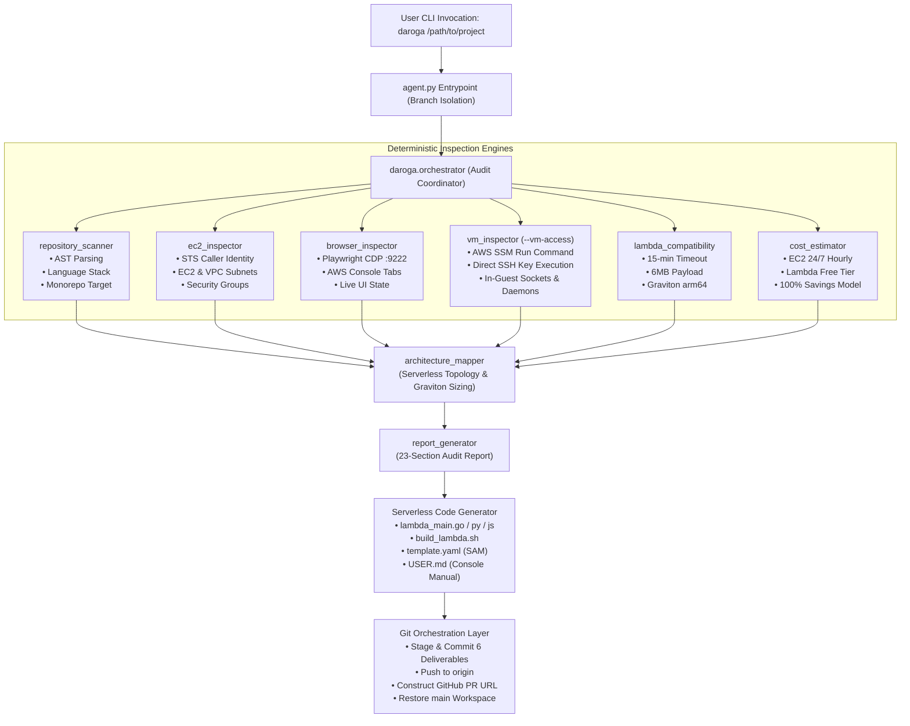
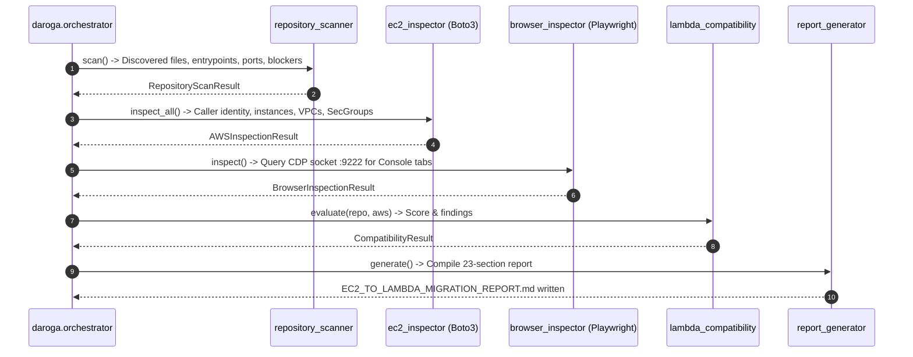
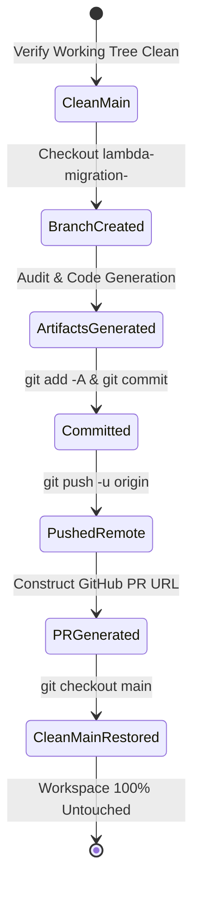
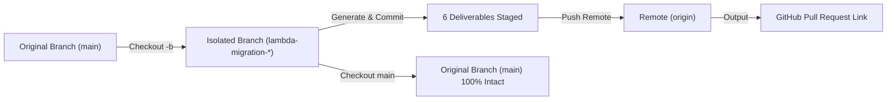

# DAROGA System Architecture

This document provides a detailed technical overview of the architecture, design principles, and inspection engine powering **DAROGA**.

---

## 1. Architectural Philosophy

DAROGA is built upon three foundational tenets:

1. **Deterministic Foundations First**: Before invoking any LLM, DAROGA executes deterministic static analysis (AST parsing, file indexing, Boto3 AWS queries, Playwright CDP socket checks). This guarantees 100% reproducible facts without hallucinations.
2. **Zero Blast Radius**: Live cloud infrastructure and the user's primary development branch (`main`) must never be modified. All mutations occur within an isolated Git feature branch (`lambda-migration-<timestamp>`).
3. **Actionable Human Direction**: Automated code generation is only half the battle. DAROGA produces both machine-executable Infrastructure as Code (`template.yaml`) and human-executable instructions (`USER.md` and `EC2_TO_LAMBDA_MIGRATION_REPORT.md`) for the AWS Management Console.

---

## 2. Component Diagram

### 2.1 Inspection Engine Subsystem Sequence

---

## 3. Modular Subsystems

### 3.1 Repository Scanner (`daroga/repository_scanner.py`)
- Traverses the target repository recursively while skipping standard build and dependency directories (`node_modules/`, `.git/`, `dist/`, `build/`, `vendor/`, `venv/`).
- Discovers languages (Go, Python, JavaScript, TypeScript, Shell), dependency manifests (`go.mod`, `package.json`, `requirements.txt`), entrypoints, and exposed network ports.
- Detects architectural blockers: persistent TCP socket listeners (`http.ListenAndServe`, `app.run()`), local disk database writes (`sqlite3`, `sqlite.Open`), WebSocket servers (`gorilla/websocket`, `socket.io`), and container daemon execution (`/var/run/docker.sock`, `exec.Command("docker")`).
- Monorepo Detection: Automatically identifies if the repository has a `backend/` directory alongside `frontend/` and scopes the serverless migration strictly to the backend service.

### 3.2 Live AWS EC2 & Infrastructure Inspector (`daroga/ec2_inspector.py`)
- Employs `boto3` and AWS CLI configuration to execute non-mutating cloud queries:
  - `sts:GetCallerIdentity`: Verifies authenticated AWS Account ID, ARN, and user/role.
  - `ec2:DescribeInstances`: Inspects running instances, instance IDs, instance types (e.g. `t3.micro`), state, public IPs, and attached IAM instance profiles.
  - `ec2:DescribeSecurityGroups`: Audits inbound port authorizations (e.g. ports 80, 443, 8080) and CIDR blocks.
  - `ec2:DescribeVpcs` & `ec2:DescribeSubnets`: Maps existing VPC topology for Lambda VPC integration.
- Fault-Tolerant Resilience: Gracefully captures permissions denials (such as AWS Service Control Policies or SCP restrictions) and falls back to deterministic infrastructure heuristics without halting the pipeline.

### 3.3 Chrome DevTools Protocol (CDP) Browser Inspector (`daroga/browser_inspector.py`)
- Leverages Playwright to connect to an existing running Google Chrome session via `http://127.0.0.1:9222`.
- Inspects active browser pages without requiring stored cookies, credentials, or re-authenticating.
- Scans for open AWS Management Console tabs (EC2 Dashboard, VPC Management, Lambda Console, CloudWatch Logs) and incorporates the user's active console context into the final report.

### 3.4 In-Guest VM Inspector (`daroga/vm_inspector.py`)
- Initiated when `--vm-access` or `--ssh-key` is supplied.
- Operates in strictly read-only, non-destructive mode via:
  1. **AWS Systems Manager (SSM) Run Command**: Zero-open-port, IAM-governed execution requiring no local SSH keys.
  2. **Direct SSH Execution**: Auto-discovers local candidate `.pem` keys in `~/.ssh/` and `~/Downloads/`, connecting to port 22.
- Captures in-guest telemetry that cannot be seen from source code alone:
  - Real listening TCP sockets and PID bindings (`ss -tulpn`)
  - Active systemd units and background services (`systemctl list-units --type=service --state=running`)
  - Running processes and memory consumption (`ps aux --sort=-%mem`)
  - Live Docker daemon status and containers (`docker ps`)
  - Deployed application directory paths (`/opt`, `/var/www`, `/home`)
  - OS distribution (`/etc/os-release`) and root disk capacity (`df -h /`)
- Injects live VM findings directly into the downstream LLM context to ground serverless code generation in actual production runtime conditions.

### 3.5 Lambda Compatibility Engine (`daroga/lambda_compatibility.py`)
- Evaluates application architecture against strict AWS Lambda service quotas:
  - **Execution Duration**: Maximum 900 seconds (15 minutes).
  - **Payload Size**: Synchronous invocation limit of 6 MB (request/response).
  - **Disk Storage**: 512 MB to 10,240 MB ephemeral `/tmp` storage.
  - **Continuous Listeners**: Evaluates converting persistent listeners to API Gateway HTTP events.
  - **Container Sandboxes**: Identifies if dynamic Docker runs need decoupling to SQS + ECS Fargate.
- Computes an overall feasibility score (0–100%) and categorizes the decision into `MIGRATE` or `MIGRATE (WITH DECOUPLING)`.

### 3.6 Architecture Mapper (`daroga/architecture_mapper.py`)
- Synthesizes the target serverless topology:
  - **Compute**: AWS Lambda running on **ARM64 Graviton** (`provided.al2023` for Go, `python3.12` for Python, `nodejs20.x` for Node.js) for 20% lower cost and higher performance.
  - **Ingress**: Amazon API Gateway HTTP API v2 with `$default` stage, `/` and `/{proxy+}` catch-all routes.
  - **Security & IAM**: Custom execution role (`<service>-LambdaExecutionRole`) with `AWSLambdaBasicExecutionRole` and VPC interface policies.

### 3.7 Cost Estimator (`daroga/cost_estimator.py`)
- Compares baseline 24/7 EC2 hourly expenditure against AWS Lambda request pricing:
  - **EC2 Baseline**: Calculates monthly instance cost (e.g. $9.99/mo for `t3.micro`).
  - **AWS Lambda Free Tier**: 1,000,000 requests/month and 3,200,000 compute seconds/month included free.
  - **Projected Savings**: Demonstrates up to 100% cost reduction for small-to-medium traffic tiers.

### 3.8 Report Generator (`daroga/report_generator.py`)
- Compiles the authoritative 23-section `EC2_TO_LAMBDA_MIGRATION_REPORT.md` combining AST data, live AWS state, CDP context, in-guest VM telemetry, compatibility evaluations, cost projections, and copy-paste-ready AWS CLI and Console instructions.

### 3.9 Serverless Code & IaC Generator (`agent.py`)
- Synthesizes language-specific serverless adapters:
  - **Go**: `backend/lambda_main.go` using `httpadapter.HandlerAdapter` and `backend/build_lambda.sh` cross-compiling the Linux `bootstrap` binary.
  - **Python**: `backend/lambda_function.py` using `apig_wsgi` or `mangum`.
  - **Node.js**: `backend/lambda.js` using `@vendia/serverless-express`.
- Generates AWS SAM template (`template.yaml`) declaring HTTP API Gateway v2, memory sizing, timeout, and architectures.
- Generates the human operator manual (`USER.md`) and migration summary (`MIGRATION_REPORT.md`).

---

## 4. Git Orchestration & Blast Radius Management

DAROGA enforces strict safety invariants:

### 4.1 Git Flow Transition Pipeline

