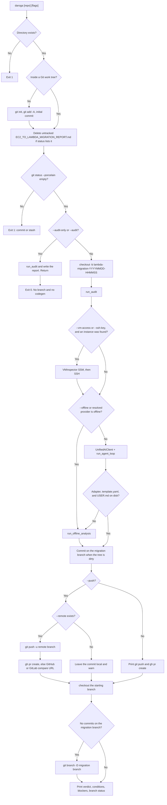
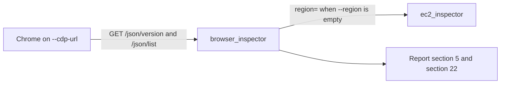

# DAROGA CLI Command Reference

Command-line reference for `daroga`, `aws-migrator`, and `aws_migrator`. All three entry points call `agent.daroga_main`.

---

## 1. Syntax

```bash
daroga [REPOSITORY_PATH] [FLAGS]
python agent.py [REPOSITORY_PATH] [FLAGS]
```

Windows wrappers in the repo root: `daroga.cmd`, `aws-migrator.cmd`, `aws_migrator.cmd`. Unix-style shims: `aws-migrator`, `aws_migrator`.

### Execution flow



---

## 2. Arguments

### Positional

- `repo` — directory to migrate. Default `.`. Resolved to an absolute path. If it is not a Git work tree, the CLI runs `git init`, `git add -A`, and commits `chore: initial commit before Lambda migration`.

### Git

- `--push` — push the migration branch and open a pull request. Default is off.
- `--no-push` — same as the default. Kept so scripts can force a local-only run.
- `--remote NAME` — remote for `--push`. Default `origin`. If that name is not in `git remote`, the commit stays local.

### Audit and cloud

- `--audit-only`, `--audit` — run `DarogaOrchestrator.run_audit` and return. No feature branch, no `--vm-access`, no model, no offline file writes.
- `--vm-access` — after a full audit, inspect `aws.instances[0]` via SSM and then SSH.
- `--ssh-key PATH` — PEM or OpenSSH private key. Implies the same guest inspection as `--vm-access`.
- `--ssh-user USER` — SSH user. Default `ubuntu`. With that default the inspector also tries `ec2-user` and `root`. Any other value is used alone.
- `--region REGION` — passed to the orchestrator. When omitted, an open AWS Console tab’s `region=` parameter is used, otherwise `AWS_REGION`, `AWS_DEFAULT_REGION`, or `us-east-1`. A region with zero instances and no `--instance-id` is followed by the candidate-region search in `EC2Inspector`.
- `--instance-id ID` — `DescribeInstances` filter. Disables the multi-region search. Guest inspection still uses `instances[0]` from that result.
- `--cdp-url URL` — default `http://127.0.0.1:9222`.
- `--output PATH` — report file. Default `<repo>/EC2_TO_LAMBDA_MIGRATION_REPORT.md`.

### Models

- `--offline` — sets provider `offline` and model `static-analysis-engine` after provider detection, so it wins over `--provider`.
- `--provider` — choices: `auto`, `groq`, `openai`, `gemini`, `claude`, `anthropic`, `xai`, `ollama`, `offline`, `heuristic`, `custom`. There is no `openrouter`, `vllm`, or `lmstudio` choice. Those endpoints use `--provider custom --base-url ...`.
- `--model` — overrides the default in the table below.
- `--api-key` — overrides the environment key for that client.
- `--base-url` — OpenAI-compatible base URL.
- `--max-turns N` — default `30` (`DEFAULT_MAX_TURNS`).

#### Defaults when `--provider` is explicit and `--model` is omitted

| Provider | Model |
|---|---|
| `groq` | `openai/gpt-oss-120b` |
| `openai` | `gpt-4o-mini` |
| `gemini` | `gemini-4-hydrogen` |
| `claude`, `anthropic` | `claude-3-5-haiku-20241022` |
| `xai` | `grok-2-latest` |
| `ollama` | `llama3.1:8b` |
| `custom` | `default` |
| `offline`, `heuristic` | `static-analysis-engine` |

#### Defaults when `--provider auto`

| Signal | Provider | Model if `--model` omitted |
|---|---|---|
| Model name contains `gpt-oss`, `120b`, or starts with `openai/` | `groq` | the name you passed |
| Model name contains `claude` | `anthropic` | the name you passed |
| Model name contains `gemini` | `gemini` | the name you passed |
| Model name contains `gpt` or starts with `o1` / `o3` | `openai` | the name you passed |
| Model name contains `grok` | `xai` | the name you passed |
| Model name contains `llama` or `mixtral` | `groq` | the name you passed |
| `GROQ_API_KEY` | `groq` | `openai/gpt-oss-120b` |
| `OPENAI_API_KEY` | `openai` | `gpt-4o` |
| `GEMINI_API_KEY` or `GOOGLE_API_KEY` | `gemini` | `gemini-2.0-flash` |
| `ANTHROPIC_API_KEY` | `anthropic` | `claude-3-5-sonnet-20241022` |
| `XAI_API_KEY` | `xai` | `grok-2-latest` |
| `OPENAI_BASE_URL` | `custom` | `default` |
| Nothing above | `groq` | `openai/gpt-oss-120b` |

Environment keys are checked in that order. A set `GROQ_API_KEY` wins over a set `OPENAI_API_KEY`.

The argparse epilog in `agent.py` still prints older default model names (`llama-3.3-70b-versatile`, `gpt-4o`, `gemini-4-hydrogen`, `claude-3-5-sonnet-20241022`). The table in this file is what `detect_provider_and_model` actually returns.

---

## 3. Environment Variables

| Variable | Use |
|---|---|
| `GROQ_API_KEY` | Groq. Also used as the first auto-detect key |
| `OPENAI_API_KEY` | OpenAI, and a key fallback for `custom` |
| `GEMINI_API_KEY`, `GOOGLE_API_KEY` | Gemini OpenAI-compatible endpoint |
| `ANTHROPIC_API_KEY` | Claude |
| `XAI_API_KEY` | xAI |
| `OPENAI_BASE_URL` | Auto-selects provider `custom` when no vendor key is set. Also the base URL for `custom` when `--base-url` is omitted |
| `OPENROUTER_API_KEY` | Read by the client for `custom` if `OPENAI_API_KEY` and `--api-key` are empty |
| `OPENROUTER_BASE_URL` | Last-resort base URL inside the client, after `--base-url` and `OPENAI_BASE_URL`. Default in code if all are empty: `http://localhost:1234/v1` |
| `OLLAMA_BASE_URL` | Ollama base when `--base-url` is omitted. Default `http://localhost:11434/v1` |
| `AWS_PROFILE` | Standard boto3 profile selection |
| `AWS_REGION`, `AWS_DEFAULT_REGION` | Region when CLI `--region` and CDP discovery do not supply one |
| `NO_COLOR` | Disables ANSI colors in the CLI logger |

---

## 4. Examples

### Local migration branch

```bash
daroga "C:\Users\username\Desktop\code\billing-service"
```

Creates `lambda-migration-<timestamp>` from the current branch, writes the report and serverless files, commits, and checks the original branch out again. Remote is unchanged. The transcript includes `git push -u origin <branch>` and a `gh pr create` line you can run yourself.

### Push and pull request

```bash
daroga "C:\Users\username\Desktop\code\billing-service" --push
```

Pushes to `origin` and runs `gh pr create --base <starting-branch> --head <migration-branch>`. If `gh` is missing or not logged in, the CLI prints `https://github.com/<owner>/<repo>/pull/new/<branch>` when the remote URL is GitHub, or the GitLab new-merge-request URL when the remote is GitLab.

### Audit only

```bash
daroga "C:\Users\username\Desktop\code\billing-service" --audit-only
```

Writes the report in the current tree. Because the report is a new untracked file, the working tree is dirty after a successful audit. The next full run deletes that untracked report before the clean-tree check.

### Guest telemetry

```bash
daroga "C:\Users\username\Desktop\code\billing-service" --vm-access
daroga "C:\Users\username\Desktop\code\billing-service" --vm-access --ssh-key ~/.ssh/my-key.pem --ssh-user ec2-user
```

Requires a full run and at least one instance from the AWS inspector. SSM is attempted first.

### Offline

```bash
daroga "C:\Users\username\Desktop\code\billing-service" --offline
```

Skips `UnifiedAIClient`. See [ARCHITECTURE.md](ARCHITECTURE.md) for how the offline writer interprets `target_runtime`.

### Chrome console

```bash
chrome.exe --remote-debugging-port=9222
daroga "C:\Users\username\Desktop\code\billing-service"
```



### Custom OpenAI-compatible endpoint

```bash
daroga /path/to/app --provider ollama --model llama3.1:8b
daroga /path/to/app --provider custom --base-url "https://openrouter.ai/api/v1" --model "meta-llama/llama-3.3-70b-instruct" --api-key "sk-or-..."
daroga /path/to/app --provider custom --base-url "http://localhost:1234/v1" --model "local-model"
```

---

## 5. Exit Status

| Code | When |
|---|---|
| `0` | The process returns normally, including audit-only and runs that logged a warning and continued |
| `1` | The target directory does not exist, the Git tree is dirty, or the `daroga` package cannot be imported in audit-only mode |

Keyboard interrupt and several codegen exceptions are caught, logged, and followed by the offline writer and the `finally` checkout. They do not by themselves set exit code 1.

### Messages you will see

- **Uncommitted changes.** Commit or stash in the target repo. An untracked report from the last `--audit-only` is removed automatically; other untracked files are not.
- **CDP is not listening.** The audit continues. The note is stored on the browser finding.
- **Remote not found.** The local migration commit remains.
- **No running EC2 instance** for guest inspection. VM step logs a warning and codegen continues without telemetry.
