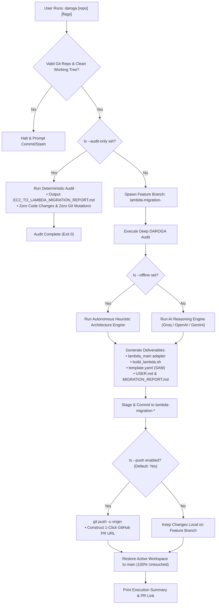
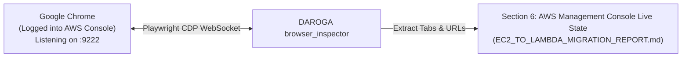

# DAROGA CLI Command Reference

This document provides a comprehensive command-line reference for the `daroga` CLI (and its aliases `aws-migrator` / `aws_migrator`).

---

## 1. Syntax Overview

```bash
daroga [REPOSITORY_PATH] [FLAGS]
```

Or using the platform wrappers:
- **Windows**: `daroga`, `.\daroga`, `aws-migrator`, `.\aws-migrator.cmd`
- **Linux / macOS**: `daroga`, `aws-migrator`
- **Python**: `python agent.py [REPOSITORY_PATH] [FLAGS]`

### CLI Execution Decision Tree



---

## 2. Arguments & Options

### Positional Arguments
- `repo` *(Optional, Default: `.`)*: The absolute or relative file path to the local Git repository you want to inspect and migrate.

### Git & Remote Options
- `--push`: *(Default: Enabled)* Automatically stages all generated artifacts, commits to an isolated feature branch (`lambda-migration-<timestamp>`), pushes to the remote Git repository, and prints the GitHub Pull Request URL.
- `--no-push`: Disables remote pushing. Changes are staged and committed strictly to the local feature branch without touching the remote.
- `--remote <NAME>`: *(Default: `origin`)* Name of the remote Git repository to push to.

### Audit & Inspection Options
- `--audit-only` (or `--audit`): Runs the complete deterministic inspection and outputs `EC2_TO_LAMBDA_MIGRATION_REPORT.md` **without** generating code, modifying files, or creating Git branches. Completely read-only.
- `--vm-access`: Enables live, non-destructive in-guest VM inspection via AWS Systems Manager (SSM) Run Command or Direct SSH execution. Discovers real listening sockets (`ss -tulpn`), active systemd services, installed runtime environments, Docker containers, and filesystem paths.
- `--ssh-key <PATH>`: Explicit path to the private SSH key (`.pem`) used to authenticate for direct in-guest VM inspection. If omitted when `--vm-access` is enabled, candidate `.pem` keys are auto-discovered from `~/.ssh/` and `~/Downloads/`.
- `--ssh-user <USER>`: Remote SSH user for VM access (default: auto-detected, typically `ec2-user`, `ubuntu`, or `admin`).
- `--region <REGION>`: Explicit AWS region to inspect (e.g. `us-east-1`, `eu-west-1`). Defaults to `AWS_REGION`, `AWS_DEFAULT_REGION`, or `us-east-1`.
- `--instance-id <INSTANCE_ID>`: Specific EC2 instance ID to target for inspection (e.g. `i-0123456789abcdef0`). If omitted, DAROGA automatically detects instances in the target region.
- `--cdp-url <URL>`: *(Default: `http://127.0.0.1:9222`)* The Chrome DevTools Protocol endpoint URL for inspecting active AWS Management Console tabs.
- `--output <PATH>`: Custom output path for the 23-section migration report. Defaults to `<repo>/EC2_TO_LAMBDA_MIGRATION_REPORT.md`.

### Execution & AI Provider Options
- `--offline`: Runs in **Zero-API Autonomous Heuristic Mode**. Generates all architecture artifacts, build scripts, SAM templates, and reports without making any external AI API calls. Zero cost.
- `--provider <PROVIDER>`: *(Default: `auto`)* Specifies the AI inference provider. Choices:
  - `auto`: Automatically detects provider from configured environment variables or model name.
  - `groq`: Fast cloud inference (Default model: `llama-3.3-70b-versatile`).
  - `openai`: OpenAI GPT models (Default model: `gpt-4o`).
  - `gemini`: Google Gemini models (Default model: `gemini-2.0-flash`).
  - `claude` / `anthropic`: Anthropic Claude models (Default model: `claude-3-5-sonnet-20241022`).
  - `xai`: xAI Grok models (Default model: `grok-2-latest`).
  - `custom` / `ollama`: Custom OpenAI-compatible endpoints.
- `--model <MODEL>`: Explicit model identifier override (e.g. `gpt-4o`, `gemini-2.0-flash`, `llama-3.3-70b-versatile`).
- `--api-key <KEY>`: Direct API key override (overrides environment variables).
- `--base-url <URL>`: Base URL override for custom OpenAI-compatible endpoints (Ollama, DeepSeek, vLLM, OpenRouter).
- `--max-turns <N>`: Maximum autonomous reasoning loops (Default: `30`).

---

## 3. Environment Variables

| Variable | Purpose |
|---|---|
| `GROQ_API_KEY` | API Key for Groq cloud inference |
| `OPENAI_API_KEY` | API Key for OpenAI API |
| `GEMINI_API_KEY` / `GOOGLE_API_KEY` | API Key for Google Gemini API |
| `ANTHROPIC_API_KEY` | API Key for Anthropic Claude API |
| `XAI_API_KEY` | API Key for xAI Grok API |
| `OPENAI_BASE_URL` | Endpoint for custom or local LLM servers (e.g. `http://localhost:11434/v1`) |
| `AWS_PROFILE` | AWS credentials profile to use for read-only cloud inspection |
| `AWS_REGION` | Default AWS region for Boto3 queries |

---

## 4. Usage Examples

### Example 1: Full Autonomous Migration with Automated Push
```bash
daroga "C:\Users\username\Desktop\code\billing-service"
```
**Action**: Creates `lambda-migration-<timestamp>`, audits the repo and AWS infrastructure, writes `EC2_TO_LAMBDA_MIGRATION_REPORT.md`, serverless adapters, and SAM template, commits, pushes to `origin`, and outputs the GitHub PR link.

### Example 2: Read-Only Audit (No Code Generation or Git Branching)
```bash
daroga "C:\Users\username\Desktop\code\billing-service" --audit-only
```
**Action**: Scans codebase, queries live AWS EC2 state, inspects browser console, and writes `EC2_TO_LAMBDA_MIGRATION_REPORT.md`. Zero code changes and zero Git branches created.

### Example 3: Local-Only Migration (No Remote Push)
```bash
daroga "C:\Users\username\Desktop\code\billing-service" --no-push
```
**Action**: Performs full migration and commits changes locally to `lambda-migration-<timestamp>` without pushing to GitHub.

### Example 4: Zero-API Offline Mode
```bash
daroga "C:\Users\username\Desktop\code\billing-service" --offline
```
**Action**: Runs the deterministic static architecture engine without requiring any LLM API keys or internet connection.

### Example 5: Enabling Live AWS Console Inspection via Chrome CDP
```bash
# 1. Start Chrome with remote debugging enabled
chrome.exe --remote-debugging-port=9222

# 2. Log in to AWS Management Console in Chrome
# 3. Run DAROGA
daroga "C:\Users\username\Desktop\code\billing-service"
```



**Action**: DAROGA connects to port 9222, identifies active AWS Management Console tabs, and integrates live console settings into Section 6 of the report.

---

## 5. Exit Codes & Troubleshooting

| Exit Code | Meaning | Resolution |
|---|---|---|
| `0` | Success | Migration or audit completed successfully. |
| `1` | Validation / Environment Error | Target directory does not exist, uncommitted changes present, or missing dependencies. |

### Common Issues:
- **"Git working tree has uncommitted changes"**: Run `git commit` or `git stash` in your target repository before executing DAROGA.
- **"Missing Dependency: botocore[crt]"**: Run `pip install "botocore[crt]"` if using AWS SSO login profiles.
- **"CDP is not listening on 9222"**: Ensure Chrome is started with `--remote-debugging-port=9222`. This is optional; DAROGA will proceed normally with heuristics if Chrome is not open.
