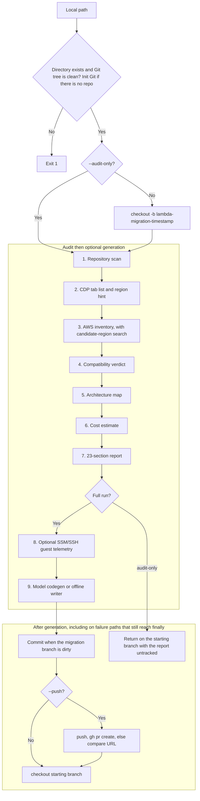
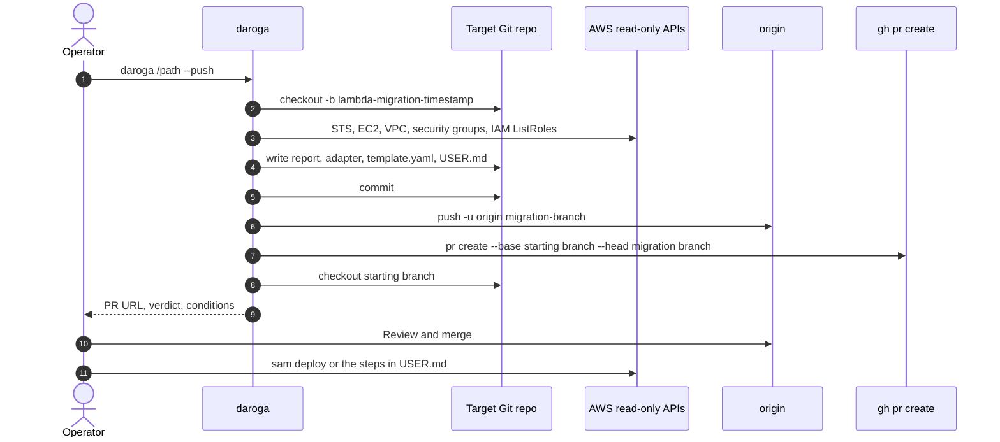

# Product Requirements Document: DAROGA (v2.0)

## Autonomous EC2 to AWS Lambda Migration Auditor & Planning Agent

| Attribute | Specification |
|---|---|
| **Product Name** | **DAROGA** |
| **CLI Commands** | `daroga`, `aws-migrator`, `aws_migrator` → `agent:daroga_main` |
| **Package version** | `2.0.0` (`pyproject.toml`, `daroga/__init__.py`) |
| **Python** | `>=3.10` |
| **Scope** | Plan a move from an EC2-hosted HTTP service to AWS Lambda. Container, WebSocket, disk, and cron findings become decoupling conditions on that plan |
| **Target runtime** | Lambda `arm64`: `provided.al2023` (Go), `python3.12` (Python), `nodejs20.x` (Node). Ingress: API Gateway HTTP API v2. IaC: AWS SAM |
| **Inspection** | Repository scanner, boto3/AWS CLI read-only inventory, CDP tab list, optional Playwright attach, optional SSM/SSH guest script |
| **Deliverables** | `EC2_TO_LAMBDA_MIGRATION_REPORT.md`, language adapter, Go `build_lambda.sh`, `template.yaml`, `USER.md`, optional GitHub or GitLab pull request |

---

## 1. Executive Summary

Given a local directory, DAROGA inspects the codebase and the caller’s AWS account, writes a 23-section report, and on a full run generates serverless files on a new Git branch. `--push` publishes that branch and attempts `gh pr create`. The branch that was checked out at start is restored afterward.

---

## 2. Scope

### In scope

- HTTP/REST services on EC2 moving to Lambda arm64 and API Gateway HTTP API.
- Monorepos: `backend/` wins over a sibling `frontend/` as `target_service_directory`.
- Scanner coverage for Go, Python, JavaScript, TypeScript, Java, and Rust. Adapter generation is implemented for Go, Python, and Node.
- Read-only AWS inventory: STS caller identity, EC2 instances, VPCs, subnets, security groups, and up to 10 IAM roles. Multi-region instance search across the candidate list in `EC2Inspector` when the first region is empty.
- CDP inspection of an already-open Chrome, including region discovery for the AWS call.
- `--vm-access` / `--ssh-key` guest diagnostics on the full migration path, fed to the model prompt.
- The 23-section report produced by `report_generator.py` (headings in the README).
- `USER.md` and `template.yaml`.
- Isolated branch `lambda-migration-<timestamp>`, opt-in push, `gh pr create` with a compare-URL fallback.
- `--offline` deterministic writer.
- Verdicts: `MIGRATE (FULLY COMPATIBLE)`, `MIGRATE (WITH CODE MODIFICATIONS)`, `MIGRATE (WITH DECOUPLING)`, `NOT RECOMMENDED`.

### Out of scope

- Calling `sam deploy`, `lambda:CreateFunction`, `ec2:RunInstances`, or any other mutating deploy API.
- Replacing the primary recommendation with ECS, EKS, or App Runner. ECS Fargate and AWS Batch appear only as the worker for Docker-in-app execution. API Gateway WebSocket API appears only as the WebSocket redesign.
- Rewriting frontend application code. `USER.md` may show a `NEXT_PUBLIC_API_URL` assignment.
- Editing the user’s Git config. Author identity is passed with per-command `git -c`.

### Decoupling conditions the engine records

| Detection | Condition text direction |
|---|---|
| Docker execution | Public API stays on Lambda. Container runs move to ECS Fargate or AWS Batch via SQS or EventBridge |
| WebSockets | API Gateway WebSocket API plus DynamoDB connection state |
| SQLite or local files | S3, DynamoDB, or RDS |
| In-process cron | EventBridge Scheduler |

---

## 3. Pipeline

### 3.1 Operator sequence for a full run with `--push`

`--push` is opt-in. The default run stops before the remote.

---

## 4. Functional Requirements

| ID | Requirement | Priority | Implementation |
|---|---|---|---|
| FR-1 | Accept a local path and operate in that tree | P0 | `repo` argument, default `.` |
| FR-2 | Refuse a dirty work tree | P0 | `is_git_clean`. Untracked `EC2_TO_LAMBDA_MIGRATION_REPORT.md` is deleted first |
| FR-3 | Initialize Git when the directory is not a repository | P0 | `git init` plus an initial commit |
| FR-4 | Scope monorepos to `backend/` when present | P0 | `RepositoryScanner` |
| FR-5 | Read-only EC2, VPC, subnet, security group, and IAM role inventory, with candidate-region fallback | P0 | `EC2Inspector` |
| FR-6 | Read Chrome CDP tabs and adopt `region=` when `--region` is empty | P0 | `BrowserInspector`, called before AWS |
| FR-7 | Score Lambda limits and emit one of the four verdicts | P0 | `LambdaCompatibilityEngine` |
| FR-8 | Write the 23-section report | P0 | `ReportGenerator` |
| FR-9 | On a full run, generate an adapter, SAM template, and `USER.md` | P0 | `run_agent_loop`, failover `run_offline_analysis` |
| FR-10 | Go builds target Linux arm64 `bootstrap` | P0 | `build_lambda.sh` from the offline writer and the system prompt |
| FR-11 | Create `lambda-migration-<timestamp>` and restore the starting branch | P0 | `daroga_main` `finally` |
| FR-12 | Push and open a PR only with `--push` | P0 | `raise_pull_request` |
| FR-13 | `--offline` performs no model HTTP call | P0 | `run_offline_analysis` |
| FR-14 | `--audit-only` writes the report and does not branch, inspect the guest, or generate code | P0 | early return in `daroga_main` |
| FR-15 | `--vm-access` collects guest telemetry for the model prompt on full runs | P1 | `VMInspector` |
| FR-16 | Cost output says ESTIMATE when no instance was found, and does not print a savings percent in that case | P0 | `CostEstimator` |

---

## 5. Security Controls

1. Inventory calls are `GetCallerIdentity`, `DescribeInstances`, `DescribeVpcs`, `DescribeSubnets`, `DescribeSecurityGroups`, and `ListRoles`. Deploy APIs are not invoked.
2. Guest inspection, when enabled, uses SSM `SendCommand` or SSH with a fixed read-only script.
3. Commits happen on the migration branch. The starting branch is checked out in `finally`.
4. CDP persistence is titles and URLs.
5. Model writes go through `safe_resolve_path`. The codegen tool list is `write_file` and `finish`.
6. The allow-listed shell prefixes in `agent.py` are not on the codegen tool list. They remain in the file for the unused `run_command` tool.

---

## 6. Artifact Matrix

| Artifact | Location | Produced by |
|---|---|---|
| `EC2_TO_LAMBDA_MIGRATION_REPORT.md` | Repo root, or `--output` | Every audit, including `--audit-only` |
| `lambda_main.go`, `build_lambda.sh` | Target service directory | Full run, Go |
| `lambda_function.py` | Target service directory | Full run, Python |
| `lambda.js` | Target service directory | Full run, Node |
| `template.yaml` | Repo root | Full run. Offline runtime id follows the note in ARCHITECTURE.md |
| `USER.md` | Repo root | Full run |
| Pull request | GitHub via `gh`, or a compare URL | `--push` only |

`lambda_app/MIGRATION_REPORT.md` and `lambda_app/USER.md` document the bundled reference service. They are not CLI outputs. That reference stack’s `template.yaml` pins Python 3.11. Generator output for new Python services uses `python3.12`.
