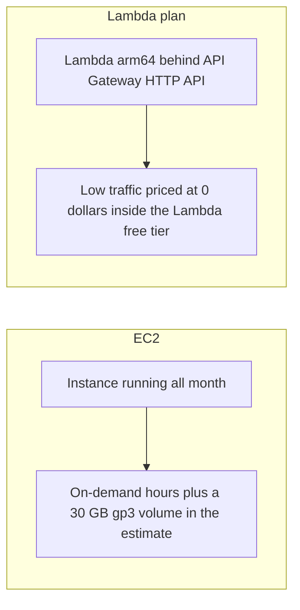
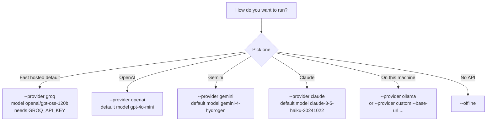
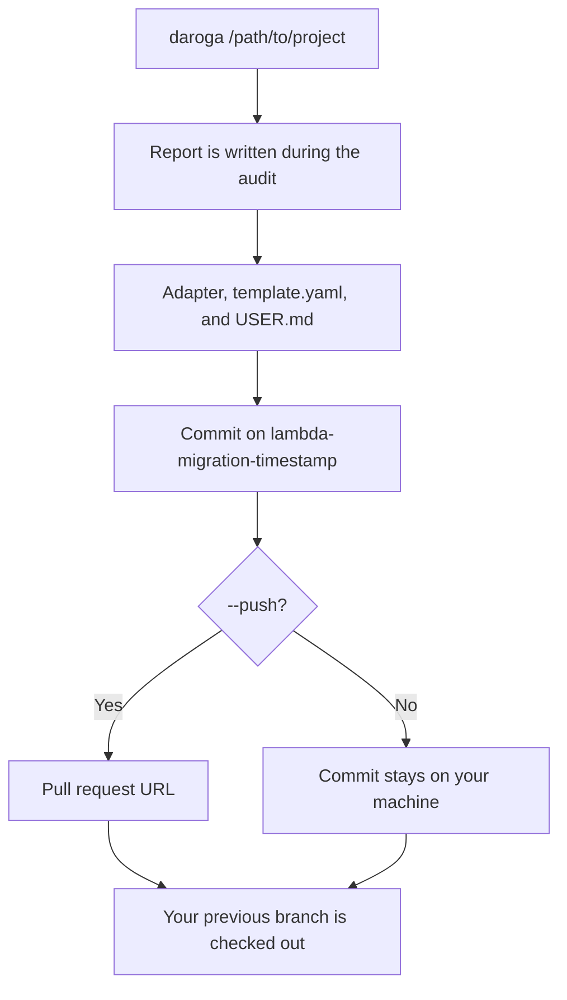

# DAROGA — Customer Quickstart

This guide is for someone running the `daroga` command. You do not need to edit the migration code by hand. DAROGA inspects a project folder, writes a report, and on a normal run also writes serverless files onto a new Git branch.

Your current Git branch is checked out again at the end. Live AWS changes are not applied. Publishing the branch is a separate choice (`--push`).

---

## 1. What you get

An EC2 instance bills for every hour it is on. Lambda bills per request, and the permanent free tier covers 1,000,000 requests and 3,200,000 GB-seconds per month. API Gateway’s 1,000,000 free HTTP API calls last for the first 12 months.

DAROGA does not shut down the EC2 instance. The report’s rollback section tells you to keep that instance until you have pointed DNS yourself.

When DAROGA cannot see a live instance, the cost section is labeled **ESTIMATE**. It does not claim a savings percentage in that situation.



| | Consulting project | This CLI |
|---|---|---|
| Time | Days to weeks of engineering | One local command |
| What is deployed | Often the new stack itself | Nothing in AWS. Files and an optional pull request |
| Risk to the instance | Depends on the project | Inventory is read-only. Guest checks with `--vm-access` run diagnostic commands only |
| Risk to Git | Depends on the project | Commits go to `lambda-migration-<timestamp>`. The branch you started on is restored |

---

## 2. Install

Python 3.10 or newer and Git.

```bash
git clone https://github.com/dhawalshankar/lambda-agent.git
cd lambda-agent
pip install -e .
```

That install includes the AWS and browser libraries. `pip install -r requirements.txt` installs only the LLM client libraries and is not enough on its own.

Optional, for the extra Playwright check against Chrome:

```bash
python -m playwright install chromium
```

The console-tab list works without that step.

---

## 3. Choosing a model

DAROGA can call a hosted model or skip the network with `--offline`.



### Groq

```powershell
$env:GROQ_API_KEY="gsk_your_key"
daroga "C:\path\to\my-app" --provider groq
```

That uses `openai/gpt-oss-120b`. Keys: [console.groq.com/keys](https://console.groq.com/keys).

If you omit `--provider`, DAROGA picks the first key it finds, in this order: Groq, OpenAI, Gemini, Anthropic, xAI, then `OPENAI_BASE_URL`. With only `GROQ_API_KEY` set, auto mode also uses `openai/gpt-oss-120b`.

### OpenAI, Gemini, Claude, xAI

```powershell
$env:OPENAI_API_KEY="sk-..."
daroga "C:\path\to\my-app" --provider openai --model gpt-4o

$env:GEMINI_API_KEY="..."
daroga "C:\path\to\my-app" --provider gemini

$env:ANTHROPIC_API_KEY="sk-ant-..."
daroga "C:\path\to\my-app" --provider claude

$env:XAI_API_KEY="xai-..."
daroga "C:\path\to\my-app" --provider xai
```

Auto mode (no `--provider`) uses different defaults than the explicit flags: OpenAI `gpt-4o`, Gemini `gemini-2.0-flash`, Claude `claude-3-5-sonnet-20241022`.

### On your own machine

```bash
daroga "C:\path\to\my-app" --provider ollama --model llama3.1:8b
```

Ollama’s default URL is `http://localhost:11434/v1`.

OpenRouter, LM Studio, and vLLM are `--provider custom` plus a base URL. `--provider openrouter` is rejected by the CLI.

```powershell
$env:OPENROUTER_API_KEY="sk-or-..."
daroga "C:\path\to\my-app" --provider custom --base-url "https://openrouter.ai/api/v1" --model "meta-llama/llama-3.3-70b-instruct" --api-key $env:OPENROUTER_API_KEY
```

```bash
daroga "C:\path\to\my-app" --provider custom --base-url "http://localhost:1234/v1" --model "local-model"
```

### No model

```bash
daroga "C:\path\to\my-app" --offline
```

### AWS credentials

If `aws configure` or environment credentials work, DAROGA reads account id, instances, VPCs, and security groups. If they do not, the report still generates and the cost block is marked as an estimate.

---

## 4. Commands

The folder must be a clean Git tree, or a plain folder (DAROGA will run `git init` and make a first commit). If you already have uncommitted work, commit or stash it first.

### Standard run

```bash
daroga "C:\Users\YourName\Desktop\code\my-application"
```

1. Scans the project, Chrome if port 9222 is open, and AWS if credentials work.
2. Writes `EC2_TO_LAMBDA_MIGRATION_REPORT.md`.
3. Writes the Lambda adapter, `template.yaml`, and `USER.md`.
4. Commits them on `lambda-migration-<timestamp>`.
5. Returns you to the branch you were on. The new commit is local until you push.

### Publish a pull request

```bash
daroga "C:\Users\YourName\Desktop\code\my-application" --push
```

Pushes to `origin` and runs GitHub CLI `gh pr create` against the branch you started from. Without `gh`, you get a link that opens GitHub’s compare page (or GitLab’s, when the remote is GitLab).

### Look inside the EC2 instance

```bash
daroga "C:\path\to\my-application" --vm-access
```

This runs only on a full migration, and only if an instance was found. It tries AWS Systems Manager first, then SSH. The default SSH user is `ubuntu`, and that default also tries `ec2-user` and `root`. The commands collected are things like `ss`, `ps`, `systemctl`, `docker ps`, and `df`. They are passed to the code generator. They are not a separate chapter of the 23-section report.

```bash
daroga "C:\path\to\my-application" --vm-access --ssh-key "$HOME\.ssh\my-key.pem" --ssh-user ec2-user
```

### Report only

```bash
daroga "C:\path\to\my-application" --audit-only
```

Writes the report and stops. No new branch and no serverless files. `--vm-access` is ignored in this mode. The new report is an untracked file; the next full run removes that untracked report automatically if it is the only leftover of that name.

### Region, Chrome, offline

```bash
daroga "C:\path\to\my-application" --region us-east-1
daroga "C:\path\to\my-application" --offline
```

Chrome, optional:

```text
chrome.exe --remote-debugging-port=9222
```

Then run `daroga` while the AWS console is open in that window. If the tab URL contains `region=`, and you did not pass `--region`, that region is the one DAROGA queries.

---

## 5. Files after a full run



| File | What it is |
|---|---|
| Pull request URL | Printed only with `--push` |
| `USER.md` | Console and `sam deploy --guided` steps |
| `EC2_TO_LAMBDA_MIGRATION_REPORT.md` | 23-section audit. Section 1 is the verdict. Section 18 is cost. Section 16 is the console clicks |
| `template.yaml` | SAM template. You deploy it; DAROGA does not |
| `lambda_main.go`, `lambda_function.py`, or `lambda.js` | The new handler, under `backend/` when the repo has that folder |

Switch to the generated commit when you want to read it:

```bash
git checkout lambda-migration-<timestamp>
git diff <your-old-branch>..lambda-migration-<timestamp> --stat
```

---

## 6. Cheat sheet

| Goal | Command |
|---|---|
| Audit, generate files, commit locally | `daroga "C:\path\to\project"` |
| Also push and open a PR | `daroga "C:\path\to\project" --push` |
| Guest ports and services | `daroga "C:\path\to\project" --vm-access` |
| Report only | `daroga "C:\path\to\project" --audit-only` |
| No model API | `daroga "C:\path\to\project" --offline` |
| Force a region | `daroga "C:\path\to\project" --region us-east-1` |
| Read an open AWS console | Start Chrome with `--remote-debugging-port=9222`, then `daroga "C:\path\to\project"` |

The branch you launched from is checked out when the command finishes. Review the migration branch before anyone deploys.
