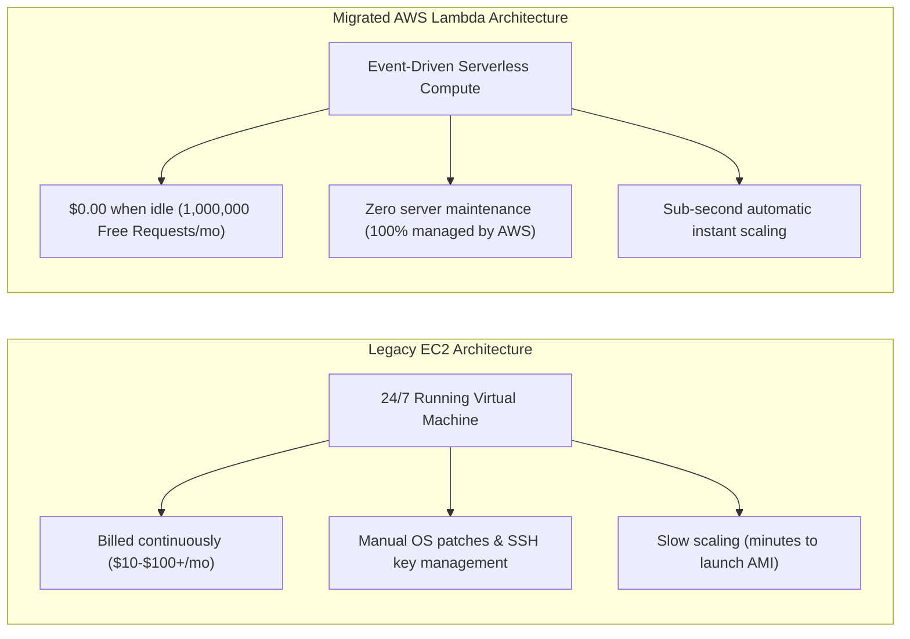
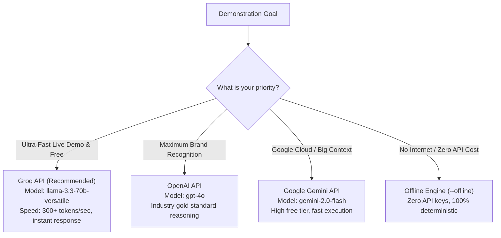
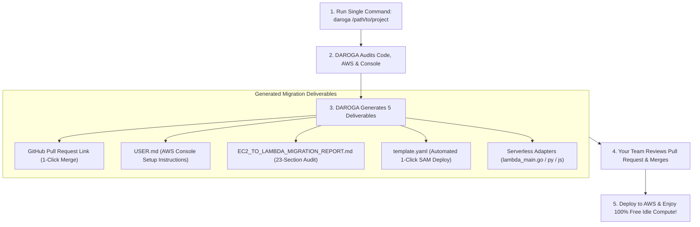

# DAROGA — Customer & End-User Quickstart Guide

Welcome to **DAROGA**! This guide is designed for **cloud operators, system administrators, business teams, and non-developers** who want to evaluate and migrate an existing AWS EC2-hosted application to AWS Lambda with minimal effort.

You do **not** need to write code or manually re-architect your infrastructure. DAROGA automatically inspects your application, checks your AWS setup, designs your serverless architecture, generates ready-to-deploy files, and prepares a GitHub Pull Request for your team to review.

---

## 1. What DAROGA Does for You

If your organization is running an application 24/7 on an AWS EC2 virtual machine, you are paying for server compute every hour—even when no traffic is arriving. 

DAROGA converts that application into **AWS Lambda Serverless**, which means:
- **Zero Server Management**: You no longer need to maintain Linux instances, patch operating systems, or manage SSH keys.
- **Pay Only When Used**: AWS provides 1,000,000 requests per month completely **free**. When nobody uses your service, you pay $0.00.
- **Automatic Instant Scaling**: Your service automatically scales up in milliseconds during high traffic and scales back down to zero.
- **Safe & Non-Destructive**: DAROGA operates with a **Zero Blast Radius** guarantee. Your existing code on `main` and your live AWS servers are **100% untouched**. Everything is delivered on a separate review branch with a Pull Request.

### Legacy EC2 vs. AWS Lambda Comparison



---

## 2. Quick Setup (3 Minutes)

### Step 1: Install Python & DAROGA
Make sure Python 3.10 or higher is installed on your machine. Then open your terminal or PowerShell and run:

```bash
# Clone DAROGA
git clone https://github.com/dhawalshankar/lambda-agent.git
cd lambda-agent

# Install dependencies and the daroga command
pip install -r requirements.txt
pip install --no-build-isolation -e .
```

You can now use the `daroga` command from any terminal on your system.

---

## 3. Environment Variables & AI Model Selection for Demos

DAROGA is an **Autonomous AI Agent**. It uses Large Language Model (LLM) reasoning loops to read your codebase, make architectural decisions, write serverless adapters, and validate generated code.

### 🌟 Which AI API Should You Use for Demonstrations?

When demonstrating DAROGA to clients, evaluators, or management, choose based on your goal:



| Provider | Recommended Model | Best For | Why Use It In A Demo? |
|---|---|---|---|
| **Groq (Top Pick)** ⚡ | `llama-3.3-70b-versatile` | **Live Stage Demos & Audits** | **Instant speed (300+ tokens/sec)**. The agent loops and tool calls run before the audience gets bored. Generous free API keys available at [console.groq.com](https://console.groq.com). |
| **OpenAI** 🧠 | `gpt-4o` | **Client & Executive Presentations** | Highest brand trust. Evaluators immediately recognize GPT-4o autonomous reasoning. |
| **Google Gemini** 🌐 | `gemini-2.0-flash` | **Cost Efficiency & Speed** | Extremely fast and generous free tier via Google AI Studio. |
| **Anthropic Claude** 🏛️ | `claude-3-5-sonnet-20241022` | **Complex Polyglot Repositories** | Unmatched code architecture synthesis and precision tool execution. |
| **Offline Engine** 🔒 | `static-analysis-engine` | **Air-gapped / Privacy-Strict Clients** | 100% free, runs without internet or keys using `--offline`. |

---

### How to Set Your API Key

Set **one** of the following environment variables in your terminal before running DAROGA:

#### Option 1: Groq (Recommended for Demo)
1. Get a free API key at: [https://console.groq.com/keys](https://console.groq.com/keys)
2. Set the key in your terminal:
   - **Windows PowerShell**:
     ```powershell
     $env:GROQ_API_KEY="gsk_your_groq_api_key_here"
     ```
   - **Windows CMD**:
     ```cmd
     set GROQ_API_KEY=gsk_your_groq_api_key_here
     ```
   - **Mac / Linux**:
     ```bash
     export GROQ_API_KEY="gsk_your_groq_api_key_here"
     ```

#### Option 2: OpenAI (GPT-4o)
1. Get an API key at: [https://platform.openai.com/api-keys](https://platform.openai.com/api-keys)
2. Set the key in your terminal:
   - **Windows PowerShell**:
     ```powershell
     $env:OPENAI_API_KEY="sk_your_openai_api_key_here"
     ```
   - **Mac / Linux**:
     ```bash
     export OPENAI_API_KEY="sk_your_openai_api_key_here"
     ```

#### Option 3: Google Gemini
1. Get an API key at: [https://aistudio.google.com/app/apikey](https://aistudio.google.com/app/apikey)
2. Set the key in your terminal:
   - **Windows PowerShell**:
     ```powershell
     $env:GEMINI_API_KEY="AIzaSy_your_gemini_key_here"
     ```
   - **Mac / Linux**:
     ```bash
     export GEMINI_API_KEY="AIzaSy_your_gemini_key_here"
     ```

---

### B. AWS Credentials (Optional, for Live Cloud Inspection)
If you have the AWS CLI configured on your computer (`aws configure`), DAROGA automatically reads your live EC2 instance details, security groups, and VPC subnets.

- If you don't have AWS credentials configured, **don't worry**—DAROGA will still inspect your repository and build all serverless deliverables using safe defaults.

---

## 4. How to Run DAROGA (Every Possible Command)

DAROGA works directly on your project folder **without needing you to copy or move files**. Just point it to your project path:

### 1. The Standard Command (Everything in One Go)
This is what most customers will run. It inspects your project, audits your AWS infrastructure, generates the serverless code, creates an isolated branch, pushes to GitHub, and gives you a 1-click Pull Request link:

```bash
# Windows
daroga "C:\Users\YourName\Desktop\code\my-application"

# Mac / Linux
daroga /home/ubuntu/projects/my-application
```

---

### 2. The "Report Only" Command (No Code Changes, No Git Push)
Use this if you just want an executive feasibility report and cost breakdown to present to your manager, without modifying code or touching Git:

```bash
daroga "C:\path\to\my-application" --audit-only
```
- **Result**: Generates an authoritative `EC2_TO_LAMBDA_MIGRATION_REPORT.md` report in your folder. Leaves all code completely untouched.

---

### 3. The "Local Only" Command (No GitHub Push)
Use this if you want DAROGA to write all the serverless code and create the feature branch on your laptop, but you **do not** want it to push to GitHub yet:

```bash
daroga "C:\path\to\my-application" --no-push
```
- **Result**: All files and Git commits remain safely on your local machine.

---

### 4. The 100% Free Offline Mode (Zero API Calls, Zero Cost)
Use this if you do not have an OpenAI or Groq API key, or if your company policy prohibits sending code to external AI APIs:

```bash
daroga "C:\path\to\my-application" --offline
```
- **Result**: Uses DAROGA's built-in static architecture engine. Runs instantly with zero external network calls.

---

### 5. Inspecting Your Live AWS Console via Google Chrome
If you are logged into your AWS Management Console in Chrome, DAROGA can inspect your open console tabs (EC2 dashboard, VPCs, Lambda) in read-only mode:

1. Close Chrome, then start it with remote debugging:
   - **Windows**: `chrome.exe --remote-debugging-port=9222`
   - **Mac**: `/Applications/Google\ Chrome.app/Contents/MacOS/Google\ Chrome --remote-debugging-port=9222`
2. Open your AWS Console tab in that Chrome window.
3. Run DAROGA:
   ```bash
   daroga "C:\path\to\my-application"
   ```
DAROGA will automatically read your open console pages and include live findings in your report!

---

## 5. What You Receive (Deliverables Explained Simply)



When DAROGA finishes, you receive 5 key deliverables:

| Deliverable | What It Is | Who It Is For |
|---|---|---|
| **GitHub Pull Request URL** | A link printed in your terminal (e.g. `https://github.com/.../pull/new/...`). Click it to review and merge all changes with one click. | Engineering Team & Management |
| **`USER.md`** | A non-technical guide showing you exact click-by-click instructions on the AWS Management Console to turn your service live. | Cloud Admin / SysAdmin |
| **`EC2_TO_LAMBDA_MIGRATION_REPORT.md`** | A 23-section comprehensive audit covering architecture suitability, security, and exact monthly cost savings. | CTO, Cloud Architect, & Finance |
| **`template.yaml` (AWS SAM)** | An automated Infrastructure-as-Code file. You can deploy your entire service in 1 command: `sam deploy --guided`. | DevOps Engineers |
| **Serverless Runtime Adapter** | Ready-to-run Lambda files (`lambda_main.go` for Go, `lambda_function.py` for Python, or `lambda.js` for Node.js). | Developers |

---

## 6. Summary Cheat Sheet

| I want to... | Command to run |
|---|---|
| Do everything (Audit, Code, Branch & Push to GitHub) | `daroga "C:\path\to\project"` |
| Get only the executive assessment report | `daroga "C:\path\to\project" --audit-only` |
| Generate files locally without pushing to GitHub | `daroga "C:\path\to\project" --no-push` |
| Run for free with no AI API key | `daroga "C:\path\to\project" --offline` |
| Specify an AWS region | `daroga "C:\path\to\project" --region us-east-1` |
| Inspect open Chrome AWS Console tabs | Open Chrome on port 9222, then run `daroga "C:\path\to\project"` |

---

## 7. Need Help or Support?
- Your original `main` branch is **always 100% safe and untouched**.
- You can review any changes before deploying using:
  ```bash
  git diff main..lambda-migration-<timestamp> --stat
  ```
- To switch to the generated migration files on your computer:
  ```bash
  git checkout lambda-migration-<timestamp>
  ```
